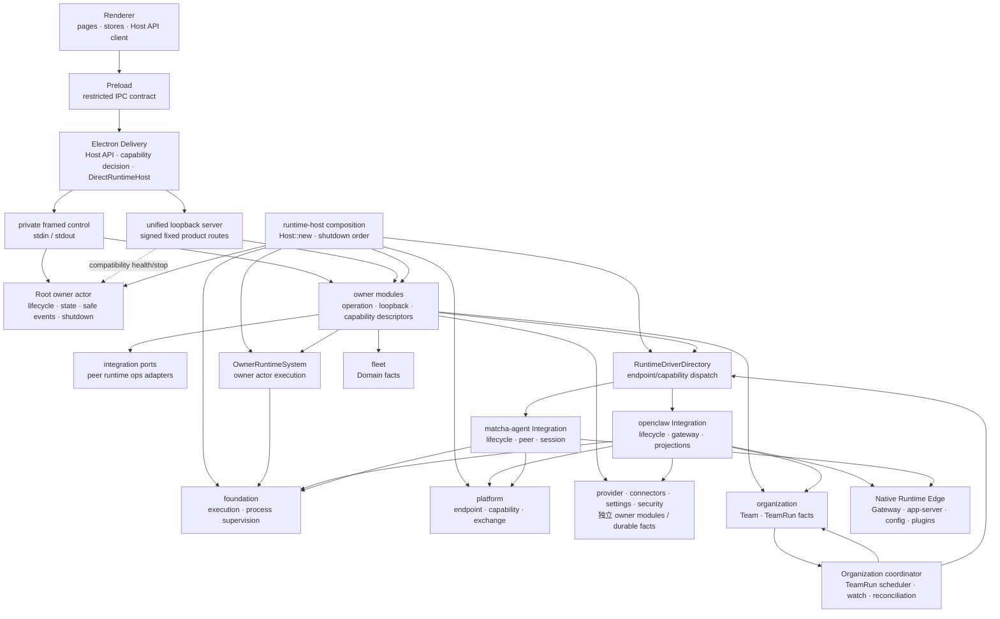
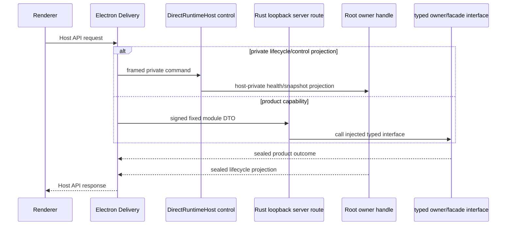
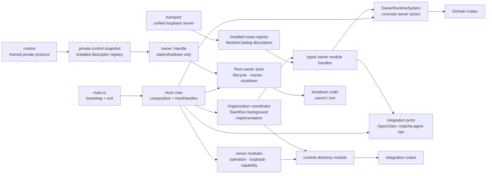
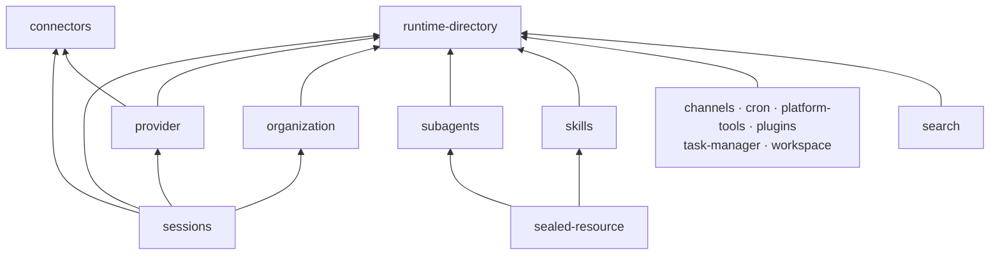
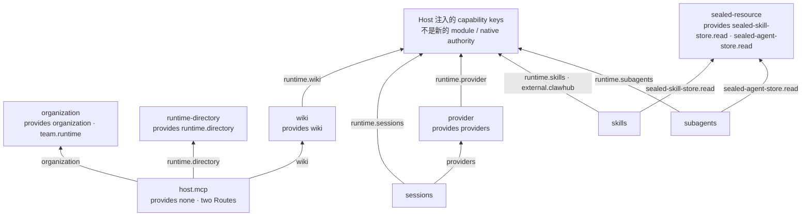
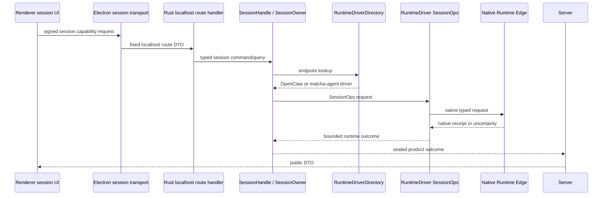
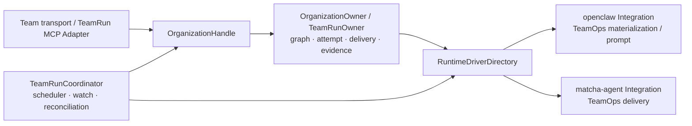

# MatchaClaw 当前分层架构

本文描述当前 **active** 的 MatchaClaw 架构：Electron Desktop Delivery 与 Rust `runtime-host` workspace 如何协作、各 crate 的事实 owner、transport seam 与编译依赖方向。

它不是 TypeScript runtime-host 的目录迁移图，不是旧 owner 审计，也不是迁移完成度账本。旧 TypeScript 路径、历史 `process-runtime` 主链和已删除的 Node runtime-host 仅可作为迁移语义证据，不能被本文表述为当前实现。

产品术语以 [CONTEXT.md](../../CONTEXT.md) 为准；迁移状态唯一以 [runtime-host-ts-rust-migration-progress.md](./runtime-host-ts-rust-migration-progress.md) 为准；Rust 终态地址空间与依赖规则以 [runtime-host-rust-target-architecture.md](./runtime-host-rust-target-architecture.md) 为准。

## 1. 当前结论

```text
Renderer
→ Electron Delivery
→ Rust runtime-host
  ├─ Root owner：lifecycle / state / safe event / shutdown
  ├─ owner modules：业务语义、operation 与 capability descriptor 的 typed boundary
  ├─ integration ports：peer runtime ops 的 typed adapter implementation
  ├─ OwnerRuntimeSystem：durable owner actor 执行
  ├─ Organization coordinator：TeamRun scheduler / watch / reconciliation
  └─ RuntimeDriverDirectory：endpoint / capability 到 peer runtime ops 的分派
→ Domain facts / Platform contracts / Runtime Integrations / Foundation mechanisms
→ Native Runtime Edge
```

- **Electron** 是桌面 Delivery：它拥有窗口、preload、OS integration、Host API proxy、受限 capability decision、Rust binary 启动及 Renderer event projection。
- **`runtime-host` binary** 是本地 runtime process，也是 Rust workspace 的唯一 concrete composition root；它不是 OpenClaw、matcha-agent 之外的第三个 peer Runtime。
- **Root owner actor** 只拥有 Host lifecycle/read-state/safe event/shutdown seam。private control 的 health/state/stop/readiness 可经 `owner::Handle`；产品行为不得再经 Root owner product command。
- **owner modules** 是业务语义、operation、loopback adapter 与 capability descriptor 的 typed boundary；业务事实仍由各自 owner 单写。新增 `modules/call-log` 只单写安全调用审计/history，不接管业务执行或 native facts，见 §5.2。
- **integration ports** 是 peer runtime ops 的 typed adapter implementation；Host 只注入 port，不保存 peer/native durable facts。
- **Foundation** 只提供 runtime-agnostic execution 与受管进程 authority/supervision mechanism。
- **Platform** 只提供跨 owner 的中性契约，例如 Endpoint、Capability、Invocation/Immediate Receipt、ModuleDescriptor/ModuleCatalog（含 effects scoped registration 校验入口）、loopback outcome、listener identity 与 pinned TLS；它不保存跨 Domain 的业务事实，也不拥有 Host listener/transport extension。[VERIFY: runtime-host/platform/src/module.rs:31-99] [VERIFY: runtime-host/platform/src/module.rs:239-304] [VERIFY: runtime-host/platform/src/loopback.rs:152-218]
- **Domain crates** 独占自己的 durable facts、状态转换、恢复与 reconciliation policy。
- **Integration crates** 独占 peer-specific lifecycle、native wire、private projection、native session/workspace semantics；它们不把 peer-private DTO 倒灌为 Domain 事实。
- **Native Runtime Edge** 是 OpenClaw Gateway、matcha-agent app-server、OpenClaw config/plugin/workspace 等真实 native owner。Rust 不复制 Native Session transcript 或 LLM execution history。

## 2. 系统结构与调用方向



箭头表示当前调用或组合方向，不是 Cargo 编译图或 capability 安装图；两种 DAG 分别见 §7.1、§7.2。`runtime-host` 仅在 composition 处同时看见具体 Domain 与 Integration；其他 crate 不通过反向依赖、全局 registry 或 generic runtime map 获得对 Host 的控制权。Organization runtime 持有自己的 actor task/coordinator，Host 决定跨 owner 顺序。

## 3. Delivery：Renderer、Electron 与 Rust 的三个 contract

Renderer public capability、Electron transport 与 Rust internal control 是三个不同的 contract。一个 Rust command 存在，不会自动成为 Renderer 能力。

### 3.1 Renderer 到 Electron

Renderer 通过 `hostApiFetch` 和 preload 暴露的受限 IPC 调用 Electron Host API。Renderer 只消费公开 DTO 和 Renderer event projection，不读取 Rust bootstrap、peer token、native path、child stderr、private state directory 或 peer-private protocol data。

Renderer 的管理选择与聊天选择完全独立、共用真实 runtime / Agent directory，页面按业务构造显式 scope，既有 Session / Team 操作保留自身 identity 而不随选择重绑定。[VERIFY: src/stores/runtime-endpoints.ts:23-36] [VERIFY: src/components/common/RuntimeScopeSelector.tsx:12-24] [VERIFY: src/components/layout/AgentSessionsPane.tsx:947-948] [VERIFY: src/stores/teams.ts:559-572]

固定 peer 注册不固定 Agent 名单：`PeerHandle` 并发通过各自 `subagent_ops` 读取已 ready 的 OpenClaw / Matcha 原生 List，将真实名单与默认项投影到同一目录；未 ready 的名单为空，ready 读取失败沿既有 unavailable 返回，不伪造 `main`。Electron 保留结构、身份与 runtime-specific 能力校验，不固定 Agent 数量；渠道等页面只消费该目录，不建立第二份名单事实。[VERIFY: runtime-host/host/src/composition/peer/handle.rs:70] [VERIFY: runtime-host/modules/runtime-directory/src/directory.rs:86] [VERIFY: runtime-host/modules/runtime-directory/src/directory.rs:250] [VERIFY: electron/main/runtime-host-delivery/transport/runtime-directory.ts:205] [VERIFY: src/pages/Channels/index.tsx:830-831]

| Module | Interface | 实现位置 |
|---|---|---|
| Renderer product entry | 页面、store、view projection 与 Host API client | `src/pages/**`, `src/stores/**`, `src/lib/host-api.ts` |
| Shared desktop contract | 公开 capability/identity/ownership 类型与纯校验、版本比较；不拥有 native/runtime 状态 | `src/types/desktop/**` |
| Preload seam | retained IPC channel 与严格 IPC contract | `electron/preload/**` |
| Main Host API | route ownership、capability decision、公开错误 envelope | `electron/api/**`, `electron/main/ipc/hostapi-proxy-ipc.ts` |

机器 License 的 canonical owner 是 Electron `main/license`，保留在线 activation、私有加密存储、离线宽限与自动复验。`/api/license/{gate,stored-key}` 为 GET，`/{validate,revalidate,clear}` 为同前缀 POST，直接进入 Main service；脱敏 gate 经 `host:event` 的 `license:gate-changed` 投影 Renderer。仅本地进入要求 granted：授权未知或 checking 时等待结果、不挂载业务页面，blocked 或读取失败才跳设置激活页；激活页和账号登录/注册保持可用，云账号 signedIn 独立放行；无 Setup、Rust License owner、`license.runtime` capability 或 `license:*` IPC。Main 不预热 gate、不以 License 阻止后台 runtime 启动；License 实例拥有快照、队列与定时器，关闭时停止接单并等待已接单操作完成。后台复验期间，仅当前已授权且缓存仍有效时保持 granted，校验结果与下一次调度时间一起发布。此处为源码接线事实，实机验证见 [Account / Cloud / Subscription](../architecture-knowledge/modules/account-cloud-subscription/dev.md)。[VERIFY: electron/main/license/composition.ts] [VERIFY: electron/main/license/node-runtime.ts] [VERIFY: electron/main/app-bootstrap.ts] [VERIFY: electron/api/routes/license.ts] [VERIFY: electron/main/host-event-bridge.ts] [VERIFY: src/App.tsx]

### 3.2 Electron 到 Rust

Electron 使用 `DirectRuntimeHost` 启动一个 Rust binary，写入一次 bootstrap frame，并保留两个不同的调用 seam：

1. **private framed control**：Electron Main 通过 stdin/stdout 长度帧发出 private control command；control 只保留 frame/wire/ready/EOF/outcome/event loop，命令 vocabulary 来自 installed module descriptors/private-control snapshot，当前 Host system handler 只覆盖 health/runtime snapshot 等 Host-private projection。
2. **signed loopback route**：Electron 在已授权的公开产品操作上签发固定 capability decision，并调用 Rust 统一 loopback server 上的 fixed module route；业务 Adapter 不经 Root owner 或 private control 分派产品行为。



`DirectRuntimeHost` 位于 `electron/main/runtime-host-delivery/direct-host.ts`。它是 Electron 的 Rust child process adapter，不是旧 TypeScript `RuntimeHostManager`、`runtime-host-client` 或 `electron/main/process-runtime/**` 的兼容替代。private control 是 Host-private framed protocol：只 decode wire envelope、通过 installed private-control snapshot 分派 Host-private handler、再 encode outcome/event；unified loopback server route 才承接 signed product DTO，并调用注入的 typed Interface。`owner::Handle` 仅覆盖 Host health/state/shutdown 等 Root lifecycle seam。

### 3.3 Rust 到 Renderer 的事件方向

Root owner 只转发 HostEvent 并更新 lifecycle 快照，受限 `SafeEvent` 由 control 投影；cron 模块的 `CronExecutionTerminalEvent` 经此链发布，公开名称仍为 `OpenClawCronExecution` / `openclaw.cron.execution`。[VERIFY: runtime-host/host/src/host_actor/actor.rs:25-50] [VERIFY: runtime-host/host/src/control/event_projection.rs:21-36] [VERIFY: runtime-host/host/src/control/wire.rs:439-444]

Session delta 不走 Root/control：Integration 转为 sessions-owned `SessionIngressEvent`，Host composition 用 sessions scope-managed pipe 接到 owner，state/delta 经 `/api/sessions/events` SSE 到 Electron `host-event-bridge`，再投影 `host:event / session.delta`。[VERIFY: runtime-host/host/src/composition/host/session_ingress.rs:18-40] [VERIFY: runtime-host/modules/sessions/src/owner/actor.rs:878-884] [VERIFY: runtime-host/modules/sessions/src/adapters/loopback/events.rs:43-70] [VERIFY: electron/main/host-event-bridge.ts:115-125] Renderer event 不反向成为 Host state 的写入通道；没有 public consumer 的 native event、raw message、tool payload、thinking、approval detail、workspace root、token 或 raw child stderr 不得跨此 seam。

### 3.4 调测日志边界

自有调测日志仅由启动环境 `MATCHACLAW_TRACE=1` 开启，默认关闭，不设等级或 Renderer 本地开关。Electron preload 只投影 `traceEnabled` 布尔值；runtime-host 与 native child 沿既有 launch environment 传递同一开关，各层在日志产生处延迟计算摘要。Browser Relay 扩展经已有成功加密握手接收同一布尔投影，断连清除。此开关不拥有业务状态，不关闭安全审计、正常错误、stderr 排空或用户主动查询的诊断事实；具体运行与验证方式见 [Telemetry / Error Handling](../architecture-knowledge/modules/telemetry-error-handling/dev.md)。[VERIFY: electron/preload/index.ts:93] [VERIFY: electron/main/runtime-host-delivery/delivery.ts:92] [VERIFY: runtime-host/platform/src/trace.rs:12]

## 4. Rust workspace：物理 owner 与职责

当前 workspace 位于 `runtime-host/`：

```text
runtime-host/
├── foundation/                 # foundation
├── platform/                   # platform
├── modules/
│   ├── provider/               # accounts / models / routing
│   ├── connectors/             # connector desired / applied
│   ├── settings/               # settings desired / effect
│   ├── search/                 # network search config / service lifecycle / native phases
│   ├── security/               # policy desired / effect / receipts
│   ├── call-log/               # safe calls + revision history, not execution
│   ├── channels/               # native channel operations
│   ├── toolchain/              # verify / prepare
│   ├── fleet/                  # fleet
│   ├── organization/           # organization
│   └── …                       # 其他已落地业务 modules
├── external/
│   ├── clawhub/                # third-party ClawHub registry/CLI
│   └── searxng/                # third-party search environment / service / HTTP protocol
├── integrations/
│   ├── openclaw/               # openclaw
│   └── matcha-agent/           # matcha-agent / matcha_agent
└── host/                       # runtime-host / runtime_host
```

`integrations/acp/` 不是当前 workspace member：当前没有 source-backed supported Delivery consumer，因此不以空 crate、fake transport 或 unavailable production implementation 占位。

| Crate | 事实 owner 与 interface | 不负责的事 |
|---|---|---|
| `foundation` | `execution` 与 `process` mechanism；受管进程 authority、observation、termination、supervision | 产品 Domain、peer wire、route、Renderer DTO |
| `platform` | Endpoint、Capability、Invocation/Immediate Receipt、listener identity、pinned TLS 的中性语言 | Session transcript、global approval、global job store、Domain reconciliation state |
| `provider` | account/model/routing stores、cascade journal、private resolver port | 明文 credential durable store、OpenClaw native auth authority |
| `connectors` | connector catalog、revision/applied revision、secret resolver port、session MCP operations | secret bytes durable store、native session authority |
| `settings` | desired state、revision/correlation、effect settlement | OpenClaw private config authority、Electron OS login-item effect |
| `search` | 独立搜索 desired config、revision/applied revision、服务操作与 native phase；见 §9.6 | SearXNG Python/process/HTTP 实现、peer native tool authority |
| `searxng` | 第三方 SearXNG 环境准备、受管服务与 HTTP protocol | 产品配置 durable facts、runtime-native provider/tool 投影 |
| `security` | policy desired/effect、operation receipts、typed native security port | signed capability issuer、已退役的聚合 grant/replay store |
| `fleet` | target/topology、lease、command/outbox、unknown/replay、audit、selector/reconcile durable facts | 未证明的 remote executor、artifact producer、public remote Delivery |
| `organization` | Team、TeamRun graph、attempt、delivery、approval、evidence、trigger 与 durable Organization facts | OpenClaw config shape、peer terminal receipt 的猜测 |
| `clawhub` | ClawHub registry HTTP catalog/search、token projection、legacy CLI install registry fallback | durable product facts、OpenClaw Gateway native skill operation、Renderer public policy |
| `openclaw` | Gateway lifecycle/wire/auth、native session/workspace、OpenClaw projections、Cron/skill/task/channel operations | Host composition、Organization command ledger、Renderer public policy、ClawHub registry catalog/search、sealed skill package owner |
| `matcha-agent` | app-server lifecycle、peer/session protocol、run/terminal receipt、approval/session translation、bounded read-only transcript history projection | Electron process lifecycle、Renderer channel、Matcha transcript writer、Matcha transcript shadow store、sealed skill package owner |
| `runtime-host` | concrete composition root、Root lifecycle/event owner、`OwnerRuntimeSystem` concrete owners、owner module handles、integration ports、control/loopback Adapter Module、module registry capability catalog、diagnostic projection、sealed skill package host-level concrete owner | 把自己变成第三个 peer Runtime；复活 Mega owner、generic `RuntimeJob`、generic job/runtime registry、Host facade drawer 或 product command enum |

### 4.1 Durable state roots

Electron bootstrap 只传递 owner-specific state root，不做跨 owner fallback：

| Root | Owner | 内容 |
|---|---|---|
| `%APPDATA%/MatchaClaw/runtime-host` | MatchaClaw Host / Rust `runtime-host` | `organization/state.sqlite`、`organization/teams/` 不可变正文、Team webhook token、`fleet-facts.log`、`fleet-private/` |
| `%APPDATA%/MatchaClaw/openclaw` | OpenClaw Integration / native OpenClaw | `openclaw.json` 仅保存 `skills.<key>.enabled`、Gateway token、private OpenClaw projection；OpenClaw 源码改动通过 bundle patch 投递 |
| `%APPDATA%/MatchaClaw/runtime-local` | `runtime-host` owner-local private material | 加密 sealed skill package material |
| `~/.matcha-agent` | matcha-agent app-server | `matcha-agent.json`、`agents/<id>/{workspace,runtime,state}`、`state/app-server.sqlite3` |

Matcha Agent 的当前正常默认根同时适用于 Electron 托管和独立 Server。Electron `getMatchaAgentHome()` 优先将已存在的 `MATCHA_AGENT_HOME` 交给 `resolve`（含空串，不 trim/展开 `~`）；未设置时，仅 `MATCHACLAW_E2E=1` 且 E2E userData trim 后非空才隔离到 `<e2eUserData>/matcha-agent`。该值经 `matcha.storageRoot` 交给 Integration 原有 `--home`，不迁移 Electron AppData 的 Host state/logs，不保留旧 Matcha AppData 默认或自动迁移。[VERIFY: electron/utils/paths.ts:46-70,83-92] [VERIFY: electron/main/runtime-host-delivery/bootstrap-resources.ts:199-202,240-254] [VERIFY: runtime-host/integrations/matcha-agent/src/lifecycle/launch.rs:225-233] [VERIFY: matcha-agent/app-server/src/main.rs:24-57] [VERIFY: matcha-agent/app-server/src/config/mod.rs:37-59]

2026-10-18 本机已在用户确认退出、复核 Electron/Host/Server/CLI 全退出后完成离线迁移，新根发布并保留旧根原数据备份。SQLite 会话路径、原生 cwd/cwd-key 等已定点重定位，用户自选外部 workspace 不动；真实 Server 从新根读回 3 条会话历史成功，未启动 CLI/Run/模型请求，真实模型 resume、UI、跨平台仍未验。当前目录见 [runtime layout](../../matcha-agent/docs/rust-app-server/runtime-layout.md#8-2026-10-18-electron-托管根统一)，检查结果见 [Integration 验证账](../architecture-knowledge/modules/openclaw-matcha-integrations/dev.md#2026-10-18-matcha-agent-家目录统一--验证边界)。

## 5. `runtime-host` 内部结构

`runtime-host/host` 不是传统 controller/service/repository 栈。它的 Depth 不在旧 Root/Mega owner，而在 **Host composition + owner module / integration port graph**：composition stages 把 bootstrap input 转成 concrete owner tasks、owner module handles、integration ports、runtime directory、module registry install plan 与 shutdown order；`Host::new()` 保持薄阶段串联和最终 assembly；Root owner 的 Interface 只保留 lifecycle/event/shutdown。这个形状把 Leverage 给 transport/control substrate，同时把 product policy 的 Locality 留在具体 owner module / integration / coordinator。



| Host module group | Interface / role | 关键路径 |
|---|---|---|
| bootstrap | 解码 private bootstrap material，构造 typed Host input | `host/src/bootstrap/**`, `host/src/main.rs` |
| composition | 创建 concrete owner tasks、owner module handles、integration ports、runtime plan 与 shutdown order；`Host::new` 只做阶段委派和 assembly | `host/src/composition/**`, `host/src/composition/host/**` |
| owner | Root lifecycle/event/shutdown Module；`owner::Handle` 是 Host lifecycle read/shutdown Seam，不是 product request Seam | `host/src/host_actor/**` |
| owner modules | Session、Provider、Settings、Security、Channel、Connector、Fleet、Organization、Plugins、Skills、Task、Workspace、Usage 等业务 module；Interface 是各自 typed handle / port / loopback adapter | `runtime-host/modules/**` |
| integration ports | OpenClaw / matcha-agent peer-specific lifecycle、driver ops 与 owner module port implementation；不保存 Host canonical facts | `runtime-host/integrations/openclaw/src/**`, `runtime-host/integrations/matcha-agent/src/**` |
| module registry | canonical module install；校验 provides/requires/effects，生成 installed route registry、private-control snapshot 与 capability catalog projection；不手写业务 descriptor directory | `host/src/module_registry/install.rs`, `host/src/module_registry/capability_catalog.rs`, `host/src/module_registry/private_control.rs`, `platform/src/module.rs` |
| runtime surface | fixed OpenClaw/Matcha peer identity、RuntimeDriver ops 聚合与 directory lookup、peer Gateway/Lifecycle adapters 与 status 转换、descriptor/scope 支持性判定、Runtime Endpoint Directory public projection 与 installed capability catalog projection | `runtime-host/host/src/composition/runtime_ports.rs`, `runtime-host/host/src/composition/peer/ports.rs`, `runtime-host/host/src/composition/peer/status.rs`, `runtime-host/modules/runtime-directory/src/**`, `runtime-host/host/src/module_registry/capability_catalog.rs`, `runtime-host/integrations/openclaw/src/driver/**`, `runtime-host/integrations/matcha-agent/src/driver/**` |
| control | private framed stdin/stdout wire、ready signal、EOF shutdown、SafeEvent/outcome encode 与 service loop；dispatch 只查 installed private-control snapshot | `host/src/control/**`, `host/src/module_registry/private_control.rs` |
| http / module loopback | 统一 loopback server、route lookup 与 Response/Stream/Upgrade 写回；authorization decision 验证和业务 DTO decode 在具体 module adapter/facade | `host/src/http/**`, `runtime-host/modules/**/src/adapters/loopback/**` |
| mcp | 同 binary stdio 组合、共享私有 signed loopback client/discovery 与两 Route；只调用已有 Organization/Wiki handles，schema/解析/业务状态留在原模块 | `host/src/mcp/{mod,stdio,client,discovery,route}.rs` |

`composition/runtime_ports.rs` 只聚合 fixed peer driver 与 typed directory lookup；`PeerHandle` 的 Gateway capability / runtime lifecycle adapters 位于 `composition/peer/ports.rs`，lifecycle/failure/startup diagnostic 的纯转换位于 `peer/status.rs`。Provider native identity/provider key/model ref 转换由 OpenClaw 既有 `surfaces/providers/adapter.rs` 实现 `ProviderRuntimeIdentityOps`，Host 仅在 directory 未 closed 时返回固定 OpenClaw identity port；原 provider identity、错误、receipt、scope 与公开 DTO 不变。[VERIFY: runtime-host/host/src/composition/runtime_ports.rs:191-230] [VERIFY: runtime-host/host/src/composition/peer/ports.rs:8-140] [VERIFY: runtime-host/host/src/composition/peer/status.rs:125-193] [VERIFY: runtime-host/integrations/openclaw/src/surfaces/providers/adapter.rs:56-98]

### 5.1 Root owner 与 typed Interface 的不变量

- Root owner 只能推进 Root lifecycle/shutdown/event projection；不能新增 product command enum 或 product mutable facts。
- Domain/product mutable facts 必须经对应 concrete owner Interface 推进；Session/Organization/Fleet/Provider/Settings/Security/Channel/Connector 等状态各自单写。
- owner module 只能持有自己明确拥有的 bounded operation state；例如 Cron terminal observation 可在 `cron` owner module 中收束，但不能升级成 Host-wide `RuntimeJob`。
- transport 只解析、验证其输入 contract 并投影固定 outcome；不复制 Domain 或 Integration policy。Loopback route 可声明整请求期限或仅 body 接收期限；Host 机械执行计时范围。Provider 修改由 owner 限制 native reconcile 预算并返回持久化/运行时双结果，不能被统一短 HTTP 期限提前抹掉已提交事实。[VERIFY: runtime-host/platform/src/loopback.rs:266-326] [VERIFY: runtime-host/host/src/http/server.rs:89-115] [VERIFY: runtime-host/modules/provider/src/owner/actor.rs:454-538]
- 长操作必须保留 cancellation 与 shutdown/join 语义；落点是拥有语义的 concrete owner、facade 或 coordinator，不是 Root/Mega owner。
- `Host` 可以组合 peer Integration，但不直接把 Gateway/app-server/private config/state 作为公开 DTO 返回。
- `main.rs` 只负责 bootstrap、入口和退出码，不承载业务状态机。

### 5.2 统一 Call Log：审计 owner，不是执行 owner

```text
21 business modules -> platform::call typed recorder/context
                    -> original owner queue / native ports / canonical facts
                    -> modules/call-log writer -> calls + call_changes
commit -> call.changed {callId,revision} -> Electron -> Calls consumer re-read
lag -> calls.resync -> active observers re-read (no periodic polling)
```

`platform::call` 只定义中性记录语言；`modules/call-log` 持有独占 writer lock、SQLite WAL/FULL 与 bounded 256 专用线程 writer，一套当前 calls + revision history。`CallId` 是调用记录身份，不能替代 run/session/dispatch 等 native identity；模块定义 safe typed detail，禁止通用 args/results、native raw 和 secrets。calls read 不递归记审计，重启 unfinished 结算 Unknown、不 replay。[VERIFY: runtime-host/platform/src/call.rs:74-105] [VERIFY: runtime-host/platform/src/call.rs:221-225] [VERIFY: runtime-host/modules/call-log/src/lib.rs:19-55] [VERIFY: runtime-host/modules/call-log/src/store.rs:19-95]

长操作仍入原 owner/module bounded queue，持久 accepted 后短返 strict 202 `CallReceipt`；原 Global/keyed/workflow 执行和 native facts 不转移。已批准范围在原 Provider 四项、Channel delete-config、Wiki 三项之外，扩展 Provider discover、Connector probe/status/sessionStatus、Channel disconnect/logout、Cron create/update/delete（toggle→update）、Skills 配置/启停/批量/卸载/产物、Subagents 创建/更新/删除/配置/包安装/export/exportCloud、Team materialize/manual create/runDelete/delete、Wiki rescan/applyGeneratedPages/deleteSource/source-task.retry/source-task.resume、Runtime stop。Provider Main 私有凭证快照/锁仍通过原 owner 私有 claim/settle 收束，本地 commit 与 native applied/observed 分开；既有后台操作不重建执行 owner。[VERIFY: runtime-host/modules/provider/src/api.rs] [VERIFY: runtime-host/modules/connectors/src/api.rs] [VERIFY: runtime-host/modules/skills/src/operation.rs] [VERIFY: runtime-host/modules/subagents/src/application/results.rs] [VERIFY: runtime-host/modules/organization/src/call.rs] [VERIFY: runtime-host/modules/wiki/src/api.rs] [VERIFY: runtime-host/host/src/composition/peer/handle.rs]

私有凭据仍由 Main 的加密库与 loopback authority 持有；Host 注入同一异步 `ConnectorSecretResolverPort`，Provider 的 Resolver 使用可共享连接池的 async HTTP client，Provider/Sessions/OpenClaw 消费者等待解析，不在 owner 的异步执行中创建 blocking runtime。缺凭据或解析服务失败只返回当前操作的安全错误；Foundation 对真正 handler panic 的停机规则不变。Team 成员错误沿原 Organization call progress 投影，不复制凭据或建立第二状态库；账户明确未准入且未 claim 才按 rejected 回滚并提示未执行，失联、已 claim 或提交后私有副作用失败仍保持 unknown。[VERIFY: runtime-host/modules/connectors/src/ports.rs] [VERIFY: runtime-host/modules/provider/src/ports.rs] [VERIFY: runtime-host/modules/provider/src/owner/accounts.rs] [VERIFY: runtime-host/modules/organization/src/ports/provision_progress.rs] [VERIFY: electron/main/ipc/provider-private-auth.ts] [VERIFY: src/lib/provider-projection.ts]

Main 的完整 Rust child restart 仍归 `RuntimeHostLifecycleOwner`，短返 restartId 并观察同次结果；updater download 复用原事件终态。Cloud package download/install preparation/agent upload/skill upload confirm 归 `CloudAccountService` 的具体 bounded operation，operationId 不冒充 Rust CallId，也不进入 CallLog；native install/export 保留独立 Rust receipt，原 account epoch、lease 与补偿边界保持。[VERIFY: electron/main/runtime-host-delivery/lifecycle-owner.ts] [VERIFY: electron/main/updater.ts] [VERIFY: electron/main/cloud-account/service.ts] [VERIFY: electron/main/cloud-account/package-operations.ts]

Sessions、Workspace、Browser 与 team.runCreate 不在此批；短查询、登录交互、内部完成屏障与 MCP 必要即时 payload 保留 original await。body deadline 仅收 body，不能代替后台化/执行预算；既有 Fleet long actions 仍 HTTP 200 accepted，不统一全部路由 202。变化提示 commit 后只带 id/revision，consumer wait 安全摘要后短读原 canonical facts 或同 callId 的模块自有 typed result；模型列表、partial 集合、Wiki 写入/删除结果与包字节不进入 CallLog，也不以最新 snapshot 冒充某次结果。模块结果有容量、完成 TTL 与原授权，读取非消费、pending 不过期、重启不恢复；sealed cloud 产物只经 signed 私有入口交 Main。Calls 不建立 global job/result store，Host 只组合注入、注册、转发与关停，Root/Foundation 不成为业务执行 owner。[VERIFY: runtime-host/platform/src/call.rs:269-319] [VERIFY: runtime-host/modules/provider/src/owner/discovery.rs] [VERIFY: runtime-host/modules/connectors/src/owner/observations.rs] [VERIFY: runtime-host/modules/subagents/src/application/results.rs] [VERIFY: runtime-host/modules/wiki/src/call_result.rs] [VERIFY: runtime-host/modules/skills/src/result.rs] [VERIFY: electron/api/routes/packages.ts]

具体 admit/await 分界见 [async-projection.md](../runtime-host-contract-v1/async-projection.md)，源码覆盖与接线/验证 OPEN 只维护于 [Call Log / Calls](../architecture-knowledge/modules/call-log/dev.md)；不以源码已写宣称 checks passed。

## 6. Domain、Platform 与 Integration 的关系

### 6.1 Platform 是语言，不是第二状态库

`platform` 为跨 crate 调用提供 Endpoint、Capability、scope、Invocation outcome、`call` 审计记录端口、ModuleDescriptor/ModuleCatalog、loopback Response/Stream/Upgrade outcome、listener identity 与 pinned TLS 的 typed grammar。[VERIFY: runtime-host/platform/src/module.rs:31-99] [VERIFY: runtime-host/platform/src/loopback.rs:152-218]

`ModuleDescriptor.effects` 是模块声明的 effect ownership 清单；`ModuleCatalog::validate_effects()` 用 `EffectRegistration` 校验 unknown module、未声明 effect 与缺失 scoped effect，其中可选 loopback descriptor 会自动计入该 module 的 scoped `Route` registration。当前 Host 安装路径由 `module_registry/install` 把 Foundation `ModuleScope` registrations 映射为 Platform effect registrations，并调用 `install_with_capabilities_and_effects()` 同时校验 capability dependency 与 scoped effects，随后派生 installed route registry、private-control snapshot 与 capability catalog projection。[VERIFY: runtime-host/platform/src/module.rs:141-204] [VERIFY: runtime-host/platform/src/module.rs:239-304] [VERIFY: runtime-host/host/src/module_registry/install.rs]

Runtime descriptor/scope 支持性由 `runtime-directory::RuntimeCapabilitySurface` 判定；Host capability catalog 仍严格验证 scope、查询 installed descriptor 后作原 `Available` veto，auth、404 与支持矩阵不变。surface 的未识别 peer/family 默认值不是授权或 grammar 校验。[VERIFY: runtime-host/modules/runtime-directory/src/domain/surface.rs:83-119] [VERIFY: runtime-host/host/src/module_registry/capability_catalog.rs:70-98] [VERIFY: runtime-host/host/src/module_registry/capability_catalog.rs:266-354]

Foundation lifecycle `ModuleScope` 是运行期 effect 生命周期 mechanism：它注册 disposer/owned task/process/listener/runtime endpoint 并按 LIFO dispose；`EffectGuard` 当前只携带 scope/effect identity。它向 Platform catalog 提供 scoped registration 事实，但不拥有 `ModuleDescriptor.effects` 契约，也不赋予普通模块 Host transport ownership。[VERIFY: runtime-host/foundation/src/lifecycle.rs:9-74] [VERIFY: runtime-host/foundation/src/lifecycle.rs:131-214] [VERIFY: runtime-host/host/src/composition/host/owner_runtime.rs:55-107]

**Invocation outcome / Immediate Receipt** 只表达调用边界能知道的事实：明确拒绝、同步完成、取消，或 effect 可能已到达目标但终局未知。它不等同最终 execution success。需要恢复的 command、attempt、delivery 和 terminal outcome 仍由真正的 Domain 或 Native Runtime owner 保存；无法判定的 effect 使用 `Unknown`，不自动重试。

### 6.2 业务 owner modules 独占各自事实

- `modules/provider`、`modules/connectors`、`modules/settings`、`modules/security` 分别拥有 account/model/routing、connector catalog、settings desired、security policy/effect stores；Host composition 逐个 spawn，不存在 Environment 聚合状态或 `modules/environment`。[VERIFY: runtime-host/host/src/composition/host/owners/runtime.rs:244-287]
- 无消费者的旧 `domains/environment` 聚合 revision/grant/reconciliation 模型退役，不视为这些业务 owner 的新增能力或等价迁移。OpenClaw `crate::environment` 安装检查与 Fleet environment/resource 生命周期保留。
- `fleet` 只保留当前能证明的本地 durable facts；adapters/application/domain/owner/store 实现 namespace private，公开 delivery/ingress/errors/ports/领域 DTO 保留，Host 经正式 OwnerInput/spawn_owner/handle 装配，不读写 FleetStore/FleetFacts。历史 RemoteFleet control plane 删除不构成新的 executor 依据。[VERIFY: runtime-host/modules/fleet/src/lib.rs:1-65] [VERIFY: runtime-host/modules/fleet/src/lib.rs:83-101]
- `organization` 负责 Team 与 TeamRun 的 graph、attempt、approval、delivery、evidence、trigger 和恢复。OpenClaw materialization 是 Integration effect，不拥有 TeamRun command ledger。

没有横切的 `session`、`approval`、`reconciliation`、`job`、`storage` 或 `facts` crate。共同字段形状不证明共同 owner。

### 6.3 Integration 独占 peer-specific private semantics

OpenClaw 私有聊天语义以原生 Web／SDK 为唯一依据；ACP 仅作历史参考，不定义当前执行规则。通信与 subscribe/history/live 仍沿既有 Gateway ordered ingress loop，不换协议、不复制 UI。chat Delta 的 message Text snapshot 仅保非空原文、忽略空／全 JS 空白，不裁有效文本尾空白；Final／Thinking 提取不改。[VERIFY: runtime-host/integrations/openclaw/src/session/protocol.rs:2191-2199] [VERIFY: runtime-host/integrations/openclaw/src/session/protocol.rs:2264-2296] live chat delta／replace／snapshot 在原 reducer 按 Web 选择，Body `stream_text` 只读当前 `Stream.text: Option<String>` 或 `Stream.closed: Vec<Closed>` 的最长前缀累计基线，`Stream.parts` 仅保存当前正文 placement slices；工具／steer rollover 清当前正文，meaningful 快照归 closed，空／全 JS 空白不进入累计。旧 `text_received`／blank reset guard 已删除，无第二累计 buffer；thinking 只切当前正文的 placement slices，不 take／关闭正文。真实工具／user rollover 一次移动正文及 slices 到 `Closed {text,parts}`；observed prefix 保存空 parts、不创建展示 ID，`accumulates`／`closed_text` 已删除。rewrite 不保留 thinking 切位前旧正文，不承诺全部 Web UI 等价。[VERIFY: runtime-host/integrations/openclaw/src/session/body.rs:35-103] [VERIFY: runtime-host/integrations/openclaw/src/session/body.rs:133-135] [VERIFY: runtime-host/integrations/openclaw/src/session/body.rs:409-504] [VERIFY: runtime-host/integrations/openclaw/src/session/body/reconciliation.rs:76-136] [VERIFY: runtime-host/integrations/openclaw/src/session/reducer.rs:918-958] [VERIFY: docs/openclaw-source/ui/src/pages/chat/chat-gateway.ts:66-89] live 明确 replacement 与迟 history snapshot 分别处理；合法 `transcriptPosition` 仅在 Integration 私有消费，物理 message sequence 不授权正文字符位置。这些事实由 Integration 投影到既有 `SessionView` / `SessionDelta`，不在 Sessions 或 Renderer 再建 peer-specific reducer。[VERIFY: docs/openclaw-source/ui/src/pages/chat/chat-history-stream.ts:116-125] [VERIFY: docs/openclaw-source/packages/gateway-client/src/session-projection.ts:208-279] [VERIFY: runtime-host/integrations/openclaw/src/session/window/history.rs:869-888] [VERIFY: runtime-host/integrations/openclaw/src/session/body.rs:692-694]

OpenClaw Body 是唯一展示归并 owner。run 当前正文与 closed 累计快照归 Body 单写；preamble 按 itemId 独立更新、保非空原文，仅按 JS trim 空白集合判空删除，已有同 item/run 的 SDK durable 接替后不被 live 覆盖。删除时重接 Part.after，不改正文基线、Part.covered 或工具 boundary；`Stream.keyed(id,start)` 与 live 前言跨 channel prefix 遮盖已删除。[VERIFY: runtime-host/integrations/openclaw/src/session/body.rs:35-103] [VERIFY: runtime-host/integrations/openclaw/src/session/body.rs:584-631] [VERIFY: docs/openclaw-source/ui/src/pages/chat/tool-stream-preamble.ts:43-103] live partial 与 causal full-part 是两个 Web consumer：前者以 same-run SDK physical assistant prefix 推进累计基线、保 suffix；后者在真实 user-turn floor／ceiling 内，以 part 全文或 rendered text 的完整覆盖退休展示。Part.after 仅定位展示，不以 tool sequence 定义因果区间，不将二者统一为全 interval。独立前言的 exact durable 接替不授权正文覆盖；Full 仅 required 正文 slices 都已覆盖／退休／为空、且活动轮无尚未接替的 live keyed 正文时关闭 current，不作全表 exact 匹配。退休 current slice 仅正文变化时以新 display ID 接续，等值更新不补新 ID，旧 ID 留 anchors，不合并 distinct durable ID。[VERIFY: runtime-host/integrations/openclaw/src/session/body/reconciliation.rs:19-73] [VERIFY: runtime-host/integrations/openclaw/src/session/body/reconciliation.rs:148-270] [VERIFY: runtime-host/integrations/openclaw/src/session/body.rs:409-463] Web 的 part.text＋causal interval 提供完整 durable 接替依据，不提供 keyed 跨 unkeyed 的 prefix 遮盖规则。 [VERIFY: docs/openclaw-source/ui/src/pages/chat/stream-reconciliation.ts:359-393] [VERIFY: docs/openclaw-source/ui/src/pages/chat/stream-reconciliation.ts:532-579] live 明确 replacement 可缩短、清空或改写；history 较短或分歧保已接受 live，恢复不清基线。Final 的 actualMessage 与 noMessage 分开：未确认展示 authority 且非 hidden 时，合格无 ID Completed 累计 Final 先沿原 chunk／reconcile 接续 run 基线，不整体物化 provisional；其余真实消息仍按严格身份关系决定保 durable 或物化 provisional，abort／error 保原行为。[VERIFY: runtime-host/integrations/openclaw/src/session/body/terminal.rs:7-58] 无消息保留已接受 tail；已确认的 Completed Final 即使无消息也清剩余正文 parts、保 thinking。明确 native Terminal 仍单独结束执行。展示只输出变化区间的局部 `ItemsReplaced`，public 合同不变，Host/Renderer 不猜去重。事件来源 run 不充作公共批次归属，各 change 保留真实归属，由 Sessions 唯一推导。[VERIFY: runtime-host/integrations/openclaw/src/session/body.rs:141-215] [VERIFY: runtime-host/integrations/openclaw/src/session/body.rs:409-504] [VERIFY: runtime-host/integrations/openclaw/src/session/body.rs:584-631] [VERIFY: runtime-host/integrations/openclaw/src/session/body/terminal.rs:5-58] [VERIFY: runtime-host/integrations/openclaw/src/session/body.rs:763-773] [VERIFY: runtime-host/integrations/openclaw/src/driver/projection.rs:20-39]

累计 Final 只接续同 run 非空当前／closed 累计基线的原文前缀：Completed、非 hidden／historyApplied，无 message_id／SDK seq／sequence、fallback／origin／mirror、imported／truncated／LargeText，afterSequence 必须 missing，内容仅 Text／Thinking。沿原 Thinking／Text replace=true chunk 与 reconcile 保新增 suffix；hidden／已确认 history 仍优先，不放宽身份唯一性或合并 distinct durable ID。精确条件见 [Session / Chat 展示接管](../architecture-knowledge/modules/session-chat/model.md#openclaw-展示接管)。[VERIFY: runtime-host/integrations/openclaw/src/session/body/terminal.rs:7-58] [VERIFY: runtime-host/integrations/openclaw/src/session/body.rs:409-504] [VERIFY: runtime-host/integrations/openclaw/src/session/body/reconciliation.rs:148-270]

native Message 保留 physical ID、canonical identity run、display itemId、三态 afterSequence 与私有位置；metadata `steerTargetRunId` 单独保存 trim／非空后的原生 run 字符串，不剥 `:user`，不代替 SDK identity run、不扩 public DTO。[VERIFY: runtime-host/integrations/openclaw/src/session/window/model.rs:341-346] [VERIFY: runtime-host/integrations/openclaw/src/session/window/history.rs:832-834]identity_message_id／identity_sequence 只认 metadata／envelope，不将兼容顶层 ID／seq 当 SDK 身份，Stream.provisional 的 Vec<Provisional> 只存必要身份 facts，不复制正文／媒体。[VERIFY: runtime-host/integrations/openclaw/src/session/body/identity.rs:3-25]Body 的即时 durable／provisional 接管按 exact 优先、否则 SDK 严格关系唯一候选：assistant／nonimported、live provisional 无 physical ID 无 native seq、canonical run 相同、durable 无 mirror 或 runTerminal；普通 Final undefined，显式 null 禁止普通 run 接管，numeric 要求 durable seq > boundary。commentary exact item/run 独立；Full 先核整批候选唯一性，不能逐条消费。durable 先到时，非累计路径的 Completed 无 ID Final 按严格唯一关系保持久正文；累计路径先于 durable_owns 接续新增 suffix，abort／error 保原行为。[VERIFY: runtime-host/integrations/openclaw/src/session/body/terminal.rs:38-58] Final 先到时 durable 显式退休旧展示 ID；不按正文合并、不合并 distinct durable ID，该接管不是下述 historyApplied 确认，也不包含 steer 选择／终态调度重裁。[VERIFY: runtime-host/integrations/openclaw/src/session/window/model.rs:241-323] [VERIFY: runtime-host/integrations/openclaw/src/session/window/history.rs:770-773] [VERIFY: runtime-host/integrations/openclaw/src/session/window/history.rs:819-856] [VERIFY: runtime-host/integrations/openclaw/src/session/body/identity.rs:28-96] [VERIFY: runtime-host/integrations/openclaw/src/session/body/terminal.rs:38-58] [VERIFY: runtime-host/integrations/openclaw/src/session/body/terminal.rs:113-134] [VERIFY: runtime-host/integrations/openclaw/src/session/reducer.rs:644-694] [VERIFY: docs/openclaw-source/packages/gateway-client/src/session-projection.ts:233-279] [VERIFY: docs/openclaw-source/packages/gateway-client/src/session-projection.ts:372-457]

Web 展示 authority 分两阶段：合格 live persistedMessage 只记 exact physical ID 候选；visible full history 确认同 exact 非 imported assistant 后才标记 `historyApplied`、退休临时终结消息并抑制 generic Final。live canonical 不等价于 history 已应用。Rust 以 Body 单一 marker 保存候选，已有 Full Latest 本次消息成功投影且最终 canonical exact assistant 仍在，原子 commit 成功后才授权；Delta／Older／Newer 不授权。Final 先到正常处理，迟确认只接管临时终结正文；thinking 使用独立新 live 展示 ID，旧临时 ID 明确退休，parts 仍沿原 prefix reconcile。合格 live 含同 ID 重发重置候选，不合格不清；Full 缺 ID 不撤已确认授权，Completed Final 不要求 ID 仍 visible。保留既有同 run／no-steal／非 origin／非 display fallback 准入，可见条件为本产品 canonical 展示成功，不宣称全部 Web 准入／隐藏过滤等价。`hasActiveRun != Some(true)` 只限定候选，缺失仍 unknown、不伪补 false；展示授权不推进 execution fence。history activity／activeRunIds 限定 Latest 接续，不抢另一 live run；thinking 已消费 delta／snapshot，但无 scope、完整跨 durable 接管未承诺；timeline 工具 payload 单写不变。[VERIFY: docs/openclaw-source/ui/src/pages/chat/terminal-message-identity.ts:65-126] [VERIFY: docs/openclaw-source/ui/src/pages/chat/chat-history-hydration.ts:240-246] [VERIFY: docs/openclaw-source/ui/src/pages/chat/chat-gateway.ts:159-160] [VERIFY: runtime-host/integrations/openclaw/src/session/body.rs:21-29] [VERIFY: runtime-host/integrations/openclaw/src/session/body.rs:149-161] [VERIFY: runtime-host/integrations/openclaw/src/session/body/terminal.rs:88-142] [VERIFY: runtime-host/integrations/openclaw/src/session/reducer.rs:644-694] [VERIFY: runtime-host/integrations/openclaw/src/session/reducer.rs:509-574] [VERIFY: runtime-host/integrations/openclaw/src/session/reducer.rs:629-637] [VERIFY: runtime-host/integrations/openclaw/src/session/body.rs:529-540]

2026-10-09 明确 native Terminal 通过 Sessions 内部 `SessionEvent.history_refresh` 表达 history 需求；accepted Applied/Consumed 后置 observation needs_sync，复用原串行同步，即使仍有 UI lease／committed view 也刷新。普通正文 delta 不每帧刷新，Matcha 全 false、原行为不变；不扩 public DTO 或新建调度 owner。[VERIFY: runtime-host/modules/sessions/src/application/commands.rs:51-57] [VERIFY: runtime-host/integrations/openclaw/src/driver/projection.rs:31-58] [VERIFY: runtime-host/modules/sessions/src/owner/actor.rs:946-954] [VERIFY: runtime-host/modules/sessions/src/owner/observation.rs:867-921] [VERIFY: runtime-host/modules/sessions/src/owner/observation.rs:1218-1229] foreign Terminal 不清另一 active run；Sessions consumer 同样保护该批 error RuntimeChanged 的归属。[VERIFY: runtime-host/integrations/openclaw/src/session/adapters/timeline.rs:855-876] [VERIFY: runtime-host/modules/sessions/src/domain/model.rs:2016-2023] [VERIFY: runtime-host/modules/sessions/src/domain/model.rs:2202-2209] [VERIFY: runtime-host/modules/sessions/src/domain/model.rs:2586-2608]

Gateway gap 在所有事件过滤之前按真实全 socket per-client seq 检测，pause/recover 复用原链；不按单 session 连续性判断。restart 清 source_epoch 为 None，下一 subscribe 按新 epoch 重绑，readiness 复用既有 watch。nested session.tool data 复用 agent decoder，input_delta/review 无 public payload、明确 ignore。[VERIFY: docs/openclaw-source/src/gateway/server-broadcast.ts:571-599] [VERIFY: runtime-host/integrations/openclaw/src/session/ingest.rs:314-369] [VERIFY: runtime-host/integrations/openclaw/src/gateway/observation.rs:68-85] [VERIFY: runtime-host/integrations/openclaw/src/gateway/client.rs:444-464] [VERIFY: runtime-host/integrations/openclaw/src/gateway/client.rs:902-921] [VERIFY: runtime-host/integrations/openclaw/src/session/protocol.rs:2656-2664] [VERIFY: runtime-host/integrations/openclaw/src/session/protocol.rs:3591-3596]

pending marker 对应的 accepted 真实持久消息／terminal，或 accepted truncated 消息，经原 router 请求 refresh、清 cursor 强制 Full；pending 未确认不保存返回 cursor，Full Latest 成功确认后恢复复用，不放宽 SDK 严格 unique。[VERIFY: runtime-host/integrations/openclaw/src/session/event_router.rs:30-98] [VERIFY: runtime-host/integrations/openclaw/src/session/ingest.rs:284-290] [VERIFY: runtime-host/integrations/openclaw/src/session/ingest.rs:493-512] LargeText 的 truncated history 沿 `NeedsContent → 原 sync future 外 get/after-get describe → HistoryContent → 原 ordered router/Body`，独立 timeline sibling 同样 hydrate。原生 get 有2,000,000 chars cap，展示为真实 UTF-8 安全32 KiB前缀及真实 bytes；loader 一次 get 后 describe。native-session fence 不是 branch fence，同 session branch race 仍 OPEN。[VERIFY: runtime-host/integrations/openclaw/src/gateway/client.rs:608-617] [VERIFY: runtime-host/integrations/openclaw/src/port/session.rs:349-390] [VERIFY: runtime-host/integrations/openclaw/src/session/content.rs:28-92]

主协调报告本轮生产 check/build 通过，不是全部 Web 正确性或截图验收；Completed hidden_control_reply 已复用 retire_body 清临时正文、保 thinking／old IDs，不删 durable／工具，不扩 abort/error 或 history authority。[VERIFY: runtime-host/integrations/openclaw/src/session/body/terminal.rs:38-47] 最终动态非全绿（A242 两项前提不足 FAIL 保留，A279／A518 PASS），tests 编译阻断、实机未部署。yielded public phase、thinking 跨 durable、Renderer 宽清洗、inbound media 权限消费者／embed sandbox 仍 OPEN。旧 PASS／旧 binary 不新证据；本轮结果见 [Session / Chat 验证边界](../architecture-knowledge/modules/session-chat/dev.md#2026-10-09-openclaw-web-正确性修复--静态事实最终验证-open)。

OpenClaw 工具 payload 归并权属于 Integration 既有 timeline `tools`：private key 为真实 `(Option run, native ID)`，source 仅存 call/result rank 与 index；public ID 为固定 SHA256 digest。整批预登记工具 pair，unknown 仅唯一 known owner 接管，Body 共享 prepared cache；`retain_tools` 同步重映射 index。来源 rank 保稀疏字段与完成态不降级，不再保第二工具 payload 镜像。非终态持久结果不依赖正文 display 变化才投递；终态迟到结果沿已有 sync，公共 terminal fence 不放宽。[VERIFY: runtime-host/integrations/openclaw/src/session/adapters/timeline.rs:4-7] [VERIFY: runtime-host/integrations/openclaw/src/session/adapters/timeline.rs:387-402] [VERIFY: runtime-host/integrations/openclaw/src/session/adapters/timeline.rs:533-559] [VERIFY: runtime-host/integrations/openclaw/src/session/adapters/timeline.rs:606-665] [VERIFY: runtime-host/integrations/openclaw/src/session/body.rs:547-570]

接收资源故障恢复保留同一 scope 的 observation handle；Sessions 先安装新 generation，再启动 sync，旧 generation 的事件仍被拒绝。OpenClaw 在有序 ingress 中移动原 actor/Body，保留正文基线、临时项与退休证据，不另建缓存；Matcha 重建接收任务，首个 sync 后从 0 完整 replay，沿原 stable ID 与 receipt 链重建投影。正常 release/idle close 仍销毁资源。[VERIFY: runtime-host/modules/sessions/src/ports.rs:70-84] [VERIFY: runtime-host/modules/sessions/src/owner/observation.rs:601-734] [VERIFY: runtime-host/integrations/openclaw/src/session/event_router.rs:67-79] [VERIFY: runtime-host/integrations/matcha-agent/src/session/adapters/observation.rs:137-189] [VERIFY: runtime-host/integrations/matcha-agent/src/session/adapters/observation.rs:480-535]

OpenClaw 原生问答不以工具运行状态或 transcript 推断：Gateway question record 是待答权威，Integration 只公开当前完整会话身份下的普通非秘密问题；秘密存储问题不投影到该 UI。Renderer 将交互挂在 composer 区域，工具历史保留非交互记录。`question.requested/resolved` 仅沿已有 socket、Host control 与 IPC 发布空 `openclaw:questions-changed` 失效提示，不传播原始内容，不另建 native 问答账本或订阅。该能力固定为 OpenClaw local；Matcha 暂不启用，不预建通用 Driver 问答接口。[VERIFY: src/types/openclaw-question.ts:3-41] [VERIFY: runtime-host/integrations/openclaw/src/session/ingest.rs:238-241] [VERIFY: runtime-host/host/src/control/event_projection.rs:54-60]

Sealed skill 的包、授权与解封仍由 Rust `sealed-resource` 持有；OpenClaw native 负责模型上下文中的引用展开，而非 Renderer 或 Host Session 投影脱敏。普通工具结果与 transcript 保存安全资源引用，正文只进入正常模型请求的临时副本；压缩保存引用而不接收正文。引用绑定包摘要，恢复时重新检查当前授权及版本；旧包已替换则拒绝，不将最新包冒充历史版本。模型上下文正文捕获在这类请求上关闭，普通诊断不变；本地包加密不保证模型绝不复述，也不追溯重写旧 transcript。[VERIFY: runtime-host/modules/sealed-resource/src/ports.rs:367] [VERIFY: runtime-host/modules/skills/src/adapters/loopback/sealed_resource.rs:426] [VERIFY: scripts/openclaw-bundle-patches.mjs:383] [VERIFY: scripts/openclaw-bundle-patches.mjs:394]

| Integration | 当前职责 | Native Runtime Edge |
|---|---|---|
| OpenClaw | Gateway auth/wire、single backend WS dispatcher、request/response/event demux、peer lifecycle、native session/window/workspace、config/channel/agent/team projection、native operation readback；session/task/team prompt 复用 `GatewayClient` control exchange，`sessions.subscribe` 不参与 Host session 主链路 | OpenClaw Gateway、OpenClaw config、plugins、Agent Workspace、native session state |
| matcha-agent | app-server lifecycle、peer/session protocol、run/terminal receipt、approval/session translation | app-server、worker、QueryEngine、native session/run state |

Integration 可以消费 Domain 的 typed port 或 intent，但不能将 OpenClaw config object graph、Gateway raw error、app-server token、native workspace root、transcript 或 raw event 变成 Platform/Domain 事实。

Matcha TaskList/Todo 的读取在 app-server `task` owner 闭合：始终读原生事项文件和 transcript 主链，不启动 CLI、不取 Provider 凭据；Session 只暴露 `native_files` / `persisted_history` 窄接口，不接管 TaskList 业务。TaskList 参与同一原生锁协议，Todo 只表示已落盘恢复值；写入仍由 CLI 原生 owner 执行。`task-context.json` 仅由 CLI 原子保存原生 listId/todoV2 binding，不是 Host/Server 任务镜像；内部读取 `instanceId:null` 不改变 product DTO、OpenClaw 或 Renderer。[VERIFY: matcha-agent/app-server/src/task.rs] [VERIFY: matcha-agent/app-server/src/task/files.rs] [VERIFY: matcha-agent/app-server/src/task/todos.rs] [VERIFY: matcha-agent/app-server/src/session/mod.rs] [VERIFY: matcha-agent/src/utils/tasks.ts] [VERIFY: runtime-host/integrations/matcha-agent/src/tasks/mod.rs]

Host 的 Matcha 执行准备仍归 Sessions：聊天 send 与 Task Create/Update/TodoWrite 复用同一 private provider prepare/model restore/projection/select；Task 通过窄 `TaskSessionPreparation` port 调用，不复制凭据流程。List/Get/TodoGet 不准备执行，OpenClaw 跳过该 Matcha 流程；Server 不反向读 Host Key，私有来源不持久化。[VERIFY: runtime-host/modules/task-manager/src/owner/actor.rs:172-190] [VERIFY: runtime-host/host/src/composition/host/ports/tasks.rs] [VERIFY: runtime-host/modules/sessions/src/owner/actor.rs:581-609] [VERIFY: runtime-host/modules/sessions/src/owner/actor.rs:1432-1444]

Provider 私密凭据链统一为 **Main encrypted vault → Host 非秘密 account → private resolver → OpenClaw SQLite auth profile**：Main 用 `safeStorage` 加密保存 API key、Token 或 OAuth material；Host 只保存 account 配置与 credential reference，由私密 resolver 解密并投影到 OpenClaw `state/openclaw.sqlite`，secret 不进入 public DTO 或通用 Host 配置。Anthropic `cliReuse` 不复制 CLI secret、不持有 credential reference，而由 native `anthropic` provider 的 `agentRuntime: { "id": "claude-cli" }` 使用 CLI 自有认证。品牌 / 套餐仍是现有 account 的 provider / endpoint，不新增 plan owner，也不改变层级。认证类型映射见 [Provider account 认证契约](../runtime-host-contract-v1/renderer-api.md#provider-account-认证契约)；实现见 `electron/main/ipc/provider-private-auth.ts`、`runtime-host/modules/provider/src/domain/account.rs` 与 `runtime-host/integrations/openclaw/src/native_config/provider_models/mod.rs`。

Provider 启动恢复由 `modules/provider` 单写：Host composition 先调用 migration，再打开原 Cascade；migration/pending/ack 由 root 的持久 `provider-recovery.v1.lock`（stdlib `File::lock`，不 unlink）串行化；实际三配置源及目标 preimage 进入 owner-only private backup，prepare 后由 Prepared/Committed marker 事务提交，只有内容无法转换才统一原格式 empty，I/O/备份失败不 reset，失败 rollback 或保留 unknown。正常 canonical 无额外备份，成功转换不提示，不改 Main secret vault、OpenClaw 配置/数据库。这里有一个受限 public path 例外：`GET /api/providers/recovery` 仅公开 `{recovery:null|{backupDirectory}}`，不公开源路径/bytes/private record；ack 持久清提示但保留备份，Main open-backup 无 path 入参、重读 pending 后调用 shell，不确认。App 根以局部 `hasObservedHostReady` 锁存既有 `runtimeHost.hostLifecycle === 'ready'`，恢复查询共用该首次门；显示另受 settings/account/license/route 门控制，暂时隐藏不清局部结果，只有显式确认成功才清提示。此门不看 OpenClaw `gatewayReady`，不新增 store/poll；原 error/断连可能留下旧 `hostLifecycle`，不能把首次加载门当完整 liveness 或重启/事件零丢失保证。启动 fatal 只由 Rust app service 的 typed ProviderMigration 错误产生 pre-ready strict length-framed `startup-failed`，Main control 严格解码，经 DirectRuntimeHost 投影 startupFailure 后显示安全 error dialog；不解析 stderr、不映射 exit code，EOF 保持原立即失败/清理。checks 与实机 OPEN 见 [Provider 验证](../architecture-knowledge/modules/provider-model-secret/dev.md#2026-10-13-provider-启动恢复验证-open)，不据接线宣称恢复验收通过。[VERIFY: runtime-host/host/src/composition/host/resources/provider_migration.rs:28-46] [VERIFY: runtime-host/modules/provider/src/adapters/migration/mod.rs:82-124] [VERIFY: runtime-host/modules/provider/src/adapters/migration/recovery.rs:36-99] [VERIFY: runtime-host/modules/provider/src/adapters/migration/recovery.rs:205-345] [VERIFY: electron/api/routes/provider-recovery.ts:13-64] [VERIFY: src/App.tsx:195-225] [VERIFY: src/App.tsx:534-538] [VERIFY: src/components/settings/ProviderRecoveryDialog.tsx:13-61] [VERIFY: src/components/settings/ProviderRecoveryDialog.tsx:84-91] [VERIFY: src/stores/gateway.ts:443-494] [VERIFY: electron/main/host-event-bridge.ts:189-200] [VERIFY: electron/main/host-event-bridge.ts:284-295] [VERIFY: runtime-host/host/src/app/service.rs:50-66] [VERIFY: runtime-host/host/src/control/wire.rs:246-267] [VERIFY: electron/main/runtime-host-delivery/control.ts:320-327] [VERIFY: electron/main/runtime-host-delivery/control.ts:398-416] [VERIFY: electron/main/runtime-host-delivery/direct-host.ts:157-166] [VERIFY: electron/main/index.ts:106-129]

渠道适配按已授权的 ClawX 行为对齐，native 基线为 OpenClaw `2026.9.2`。渠道配置、绑定与登录材料属于 OpenClaw Integration / native owner，不是 Host durable facts；Host 只编排登录 finalization 与既有 Foundation supervisor。配置成功后，登录 finalization，或外部托管插件配置 `Noop` / `peer_link` 失败，需要在 supervisor 为 `Running` 时请求 restart；普通 changed 配置交给 native reload，不重复重启。渠道插件 prepare 使用实际 OpenClaw 包根，由 managed reconciliation 的 `plugin_peer_link.rs` 修复插件 host link（Windows junction / Unix symlink），经 canonical readback 返回真实 `peer_link_ok`；该修复不改安装账本、不重建 native scanner。非 running 时，status/read 读取 native config store，configure/delete 锁内原子提交；form/read 的 schema 来自本地插件原生 channel descriptor，飞书/微信读取实际 channel schema export，不使用插件级 schema 冒充渠道字段。企微原生插件未提供 channel schema，表单采用既有 ClawX/产品 descriptor，并以实际插件 account reader 核验 `botId` / `secret` 语义，不冒称 native schema；公共 read 只投影非敏感标量。是否离线以 supervisor 提供的 `runtime_running` 为准，不能因 RPC 失败盲目回退本地；running mutation 的 `MayHaveReached` 只允许只读确认，不以离线写入兜底。具体提交、删除范围及限制见[渠道契约](../runtime-host-contract-v1/routes.md#d-openclaw--provider--settings--skills--channel-reads)。

渠道配置读取在原有安全字段投影之外，单独公开可空 `agentId`，仅表达 native `bindings` 中该渠道/账号明确的简单 route binding；不解析消息级路由、不推断默认智能体、不在 Host 或 Renderer 缓存第二份绑定事实。Electron 严格校验后由配置弹窗回填，不扩展渠道 snapshot。[VERIFY: electron/main/runtime-host-delivery/transport/channels/config-read.ts:17-20] [VERIFY: electron/main/runtime-host-delivery/transport/channels/config-read.ts:87-92] [VERIFY: electron/api/routes/channel-config-read.ts:40-44]

OpenClaw `2026.9.2` 的 SQLite state 与微信插件 `openclaw-weixin/accounts.json` 账户索引、`accounts/<accountId>.json` 登录材料是不同的 native 存储，不能相互替代。渠道快照在非 running 时读取 native config store、零 RPC；微信账户取自插件索引，未登录仍保留已配置渠道项，但不虚构 `default` 账户。running 时保留 native 状态事实，RPC 失败保持失败/unknown，不伪造离线快照。实现见 `runtime-host/integrations/openclaw/src/surfaces/channels/adapter.rs`、`runtime-host/modules/channels/src/**` 与 `runtime-host/integrations/openclaw/src/surfaces/channels/gateway/status.rs`。

OpenClaw 安装记录 reconciliation 将 `plugins.installedIndex.index` 持久化为仅含完整 `installRecords` 的账本，保留第三方记录及记录扩展字段，清除派生索引；外层元数据保留，revision 复用原事务更新。OpenClaw 在启动时自行发现并在内存重建索引，Rust 不扫描重建原生索引，也不调用刷新 CLI。

飞书插件由 Matcha 维护 `packages/openclaw-lark` 并通过既有 managed builder → `build/openclaw-plugins/openclaw-lark` → after-pack → `resources/openclaw-plugins/openclaw-lark` 交付，替代官方 npm 下载与 SDK 文本补丁；Rust 读取独立 `dist/config-schema.mjs` 的 `FEISHU_CONFIG_JSON_SCHEMA`，插件/渠道身份及渠道 owner 不变。[VERIFY: scripts/lib/openclaw-local-plugin-builder.mjs:10-13] [VERIFY: scripts/lib/openclaw-local-plugin-builder.mjs:237-243] [VERIFY: scripts/after-pack.cjs:664-682] [VERIFY: runtime-host/integrations/openclaw/src/surfaces/channels/gateway/config/local_schema.rs:195-197]

## 7. Process lifecycle ownership

受管 runtime lifecycle 的职责固定如下：

```text
Foundation
→ runtime-agnostic process authority / observation / termination / supervision mechanism

Runtime Integration
→ peer-specific launch / readiness / graceful stop / recovery / logs / restart policy

Host
→ concrete composition, cross-instance start dependency, shutdown / join order

Electron Delivery
→ launch and connect Rust runtime-host; desktop shell and safe transport
```

每个受管 process instance 的 process handle、provenance、authority scope 和 lifecycle state 只由其 Foundation Supervisor 单写。Host 和 Integration 通过 typed command/request 操作；未知 port occupant 未证明是 Matcha-owned 时不得被终止。

Electron 不拥有 OpenClaw 或 matcha-agent 的 semantic lifecycle policy。Electron 启动并连接 Rust `runtime-host`；Rust Host 组合具体 peer Integration、决定 runtime dependency 与 shutdown order。

OpenClaw repair 的手动按钮与自动启动恢复共用 Integration `OpenClawDriver::repair`；`start_with_effects`、`repair` 与 `confirm_stopped` 固定使用 driver 自身的 `LifecycleOps`，不接受外传 lifecycle。`start_with_effects` 拥有自动资格与停止确认，repair 拥有 phase/失败决策：停止确认 → native doctor → 原 owner 准备 → start/readiness/ready projection。Host 通过 `StartupEffects` 保留 Provider/Settings/Security 准备、Organization receipt recovery、shutdown signal、原始 start cache/notify 与公开错误投影，native 准备时序不变。doctor 成功、报错、无法启动或超时后已确认自有 child 回收，均继续尝试启动；doctor 异常只留日志。停止/端口检查失败、doctor 取消或 child 回收未确认仍阻断，修复成功以原启动就绪与 ready projection 完成为准。Integration 单写有界 repair 快照与 lifecycle permit；入 lane 前拒绝冲突。普通启动和准备失败只记录启动结果，只有进入 repair 的失败才写修复终态。自动资格仍只来自停止旧进程后重新采集的 native 明确迁移信号，不凭 Host 准备失败猜测，不加版本升级 marker。端口占用不授权 kill；shutdown 由 Host signal 触发 Integration 取消 doctor 并等待自有 child 回收。Main/Renderer 只消费原签名 API、CallReceipt 与安全进度，不建立第二修复 owner。[VERIFY: runtime-host/integrations/openclaw/src/driver/repair.rs:17-120] [VERIFY: runtime-host/integrations/openclaw/src/driver/repair.rs:133-200] [VERIFY: runtime-host/integrations/openclaw/src/driver/lifecycle.rs:17-57] [VERIFY: runtime-host/host/src/composition/peer/openclaw.rs:32-60] [VERIFY: runtime-host/host/src/composition/peer/openclaw.rs:119-234] [VERIFY: runtime-host/host/src/composition/peer/openclaw.rs:243-330] [VERIFY: runtime-host/host/src/composition/peer/handle.rs:173-224] [VERIFY: electron/api/routes/gateway.ts:64-81]

Peer helpers 按实际调用收窄依赖：查询 helper 只接 admission、directory 与查询参数，Matcha autostart 只接 `LifecycleOps`，启动结果留在 actor 记录；状态参数组装集中到既有 `PeerShared::runtime_state`，status 仍只接实际依赖。OpenClaw prepare/ready helpers 接实际 owner/driver 引用，既有 `OpenClawStartupEffects::new(shared, bool)` 统一提取借用，不保存整个 `PeerShared`。这不禁止 Host 组合 Provider/Settings/Security/Organization/TeamRun 的跨 owner 启动 effects，也不改变原准备顺序、receipt recovery 或 Integration fixed-self repair ownership。[VERIFY: runtime-host/host/src/composition/peer/actor.rs:110-120] [VERIFY: runtime-host/host/src/composition/peer/actor.rs:283-287] [VERIFY: runtime-host/host/src/composition/peer/actor.rs:741-830] [VERIFY: runtime-host/host/src/composition/peer/matcha.rs:5-9] [VERIFY: runtime-host/host/src/composition/peer/openclaw.rs:142-196] [VERIFY: runtime-host/host/src/composition/peer/openclaw.rs:243-330]

### 7.1 Cargo 编译依赖 DAG

箭头为编译消费者 → 被依赖 crate。下图摘录 module→module 声明边；Six 节点合并六个独立 module，不是聚合 crate，基础层与 Integration/Host 的其他边见表。边界脚本从 `cargo metadata --offline --no-deps` 读取实际图，包含 optional、target、dev/build 声明，不按当前激活 feature 缩减；本次 search → runtime-directory 已纳入显式边清单。[VERIFY: scripts/check-runtime-host-crate-dag.mjs:7-112] [VERIFY: runtime-host/modules/search/Cargo.toml:9-12]



| Crate | 当前 workspace 编译依赖（摘录） | 架构含义 |
|---|---|---|
| `foundation`、`platform` | 均无内部 workspace 依赖 | mechanism 与中性 contract 不看见业务或 peer |
| `channels`、`cron`、`platform-tools`、`plugins`、`skills`、`subagents`、`task-manager`、`workspace` | `foundation`, `platform`, `runtime-directory` | 固定 peer identity/capability/lifecycle 语言，不导入具体 driver |
| `runtime-directory` | `foundation`, `platform` | 固定 peer 目录与中性能力语言 |
| `provider` | `foundation`, `platform`, `connectors`, `runtime-directory` | 消费 Connector secret port，不取其 owner/store |
| `sessions` | `foundation`, `platform`, `connectors`, `organization`, `provider`, `runtime-directory` | 消费正式 ports、Role receipt 与 Provider API，不反向迁移事实 |
| `connectors`、`settings`、`security`、`fleet` | `foundation`, `platform` | 各自业务 owner，不依赖 Host |
| `organization` | `foundation`, `platform`, `runtime-directory` | Team/TeamRun 模型、私有 store 与 owner-local execution |
| `sealed-resource` | `platform`, `skills`, `subagents` | 实现二者声明的 sealed store ports |
| `clawhub` | 无内部 workspace 依赖 | 第三方 client，不是 peer runtime |
| `search` | `foundation`, `platform`, `runtime-directory`, `searxng` | 产品配置/lifecycle/native phase owner，经 Host 注入 native ports |
| `searxng` | `foundation` | 第三方服务；自声明 `PythonEnvironment` port，由 Host 注入 toolchain 实现，不反向依赖 module。[VERIFY: runtime-host/external/searxng/Cargo.toml:8-17] [VERIFY: runtime-host/external/searxng/src/lib.rs:96-117] |
| `openclaw` | `foundation`, `platform`、具体业务 modules、`clawhub`, `toolchain` | 实现业务 ports 与 OpenClaw native effects |
| `matcha-agent` | `diagnostics`, `foundation`, `organization`, `platform`, `runtime-directory`, `sessions`, `toolchain` | 实现 app-server lifecycle/session/Team ports |
| `runtime-host` | 当前具体基础、业务、Integration 与 external crates | 唯一 concrete composition |

Organization 不能直接 import OpenClaw：所需 effect 通过正式 ports 表达，只在 Host composition 注入具体 adapter。边界脚本以实际 metadata 校验分层、环与显式 module 边清单；source lexical guard 仅辅助检查本文件 direct/grouped/import alias/extern alias/pub use，不是 Rust parser、跨文件名称解析或 macro 展开。实现 namespace 的 private 约束由 Rust visibility 与 compiler 执行，不据此宣称整个 workspace owner-first 已完成。[VERIFY: scripts/check-runtime-host-crate-dag.mjs:122-240] [VERIFY: runtime-host/modules/organization/src/lib.rs:5-14] [VERIFY: runtime-host/modules/fleet/src/lib.rs:1-10]

### 7.2 Runtime capability 安装 DAG

箭头为 descriptor 消费者 → 提供 required capability 的 module 或 Host 注入源；这是 `ModuleDescriptor.provides/requires` 的安装校验图，不是上面的 Cargo 图、peer 支持矩阵或授权图。下图只展示本轮相关子图：Organization、runtime-directory、sealed-resource 无 requires；Wiki requires Host 注入的 `runtime.wiki`；`host.mcp` 不提供 capability，只声明两项 Route effect，requires `organization/runtime.directory/wiki`。[VERIFY: runtime-host/platform/src/module.rs:141-204] [VERIFY: runtime-host/modules/wiki/src/lib.rs:39-42] [VERIFY: runtime-host/host/src/module_registry/install.rs:17-100]



`sealed-resource → skills/subagents` 是编译时实现 ports；`skills/subagents → sealed-resource` 是运行期消费 sealed read capability，两图的反向边不构成同一图里的环。MCP requires Organization/Directory/Wiki 不代表获得 native caller 身份；availability 和 signed capability decision 仍沿各自原边界。[VERIFY: runtime-host/modules/skills/src/lib.rs:29-35] [VERIFY: runtime-host/modules/subagents/src/lib.rs:21-30] [VERIFY: runtime-host/modules/sealed-resource/src/ports.rs:27-32] [VERIFY: runtime-host/modules/sessions/src/lib.rs:78-99] [VERIFY: runtime-host/modules/provider/src/lib.rs:24-29] [VERIFY: runtime-host/host/src/module_registry/install.rs:17-99]

## 8. 启动、transport 与 shutdown 的真实结构

### 8.1 Bootstrap 与启动

Electron `bootstrapMainApplication()` 同步返回 `MainApplication { mainWindow, ready: Promise<void>, close: () => Promise<void> }`，`index` 立即保存 owner，不等 Rust 启动才取得关停入口。Main event bridge、License 与云账号 service 在 Rust ready 前构造；同步派生 `apiRuntime` 并挂 rejection handler 后注册 static IPC，再启动唯一 Host API listener、account prewarm 与 Renderer 加载，不等 Rust。Gateway/fleet/diagnostics runtime IPC 仍在完整依赖接线后注册。`ready` 仍等待监听、runtime 接线及原启动收尾；Host API 已监听不等于 Rust/peer ready。[VERIFY: electron/main/app-bootstrap.ts:150-160] [VERIFY: electron/main/app-bootstrap.ts:197-204] [VERIFY: electron/main/app-bootstrap.ts:259-275] [VERIFY: electron/main/app-bootstrap.ts:312-345] [VERIFY: electron/main/app-bootstrap.ts:386-388] [VERIFY: electron/main/index.ts:203-217]

server 与 proxy 共用 `getHostApiRequestDependency(method, pathname)`：现有请求 tuple 仅给 License、账号、billing、subscription、Main 日志与 Browser Relay 信息标 `'main'`，其余允许请求默认 runtime；public allowlist 不变，snapshot 仍只输出原 method/path。Main 请求只等 listener；runtime 请求在 proxy 同时等 listener 与 `apiRuntime`，server 按同一分类 await 完整 context 后进入 runtime handler，不再试 Main 后 fallback，也不以空 transport、占位 runtime 或第二个 server 兜底。默认 30 秒覆盖 readiness 等待，原长 admission 预算规则保留；这只是请求依赖分发，不保证每个 Main 账号操作内部均不等待 native 副作用。[VERIFY: electron/api/context.ts:27-38] [VERIFY: electron/api/route-boundary.ts:348-364] [VERIFY: electron/api/route-boundary.ts:416-423] [VERIFY: electron/api/route-boundary.ts:505-508] [VERIFY: electron/api/route-boundary.ts:638-654] [VERIFY: electron/api/route-boundary.ts:670-684] [VERIFY: electron/api/server.ts:246-249] [VERIFY: electron/api/server.ts:340-375] [VERIFY: electron/main/ipc/hostapi-proxy-ipc.ts:109-131] [VERIFY: electron/main/ipc/hostapi-proxy-ipc.ts:244-274] [VERIFY: electron/main/ipc/hostapi-proxy-ipc.ts:315-325]

Renderer App 挂载即初始化 Gateway、账号与更新；settings/Provider 首次初始化与 recovery 查询等待 App 局部 `hasObservedHostReady` 锁存既有 `runtimeHost.hostLifecycle === 'ready'`，不等 OpenClaw `gatewayReady`。恢复弹窗的查询门与原 settings/account/license/route 显示门分开，结果保留组件局部状态，不造 store/poll/retry。这个 Host 字段及首次锁存都不是完整 liveness：原异常/断连可保留旧值，不能据此承诺重启期间请求可用、事件不丢或全功能 ready。[VERIFY: src/App.tsx:195-240] [VERIFY: src/App.tsx:242-296] [VERIFY: src/App.tsx:534-538] [VERIFY: src/components/settings/ProviderRecoveryDialog.tsx:13-52] [VERIFY: src/components/settings/ProviderRecoveryDialog.tsx:84-91] [VERIFY: src/stores/gateway.ts:443-494] [VERIFY: electron/main/host-event-bridge.ts:189-200] [VERIFY: electron/main/host-event-bridge.ts:284-295]

异步 runtime 分支仍由 `DirectRuntimeHost` 启动 Rust child，并写入一次性 stdin bootstrap frame。Rust `host/src/main.rs` 在 Host 模式读取 bootstrap、拆出 typed input/runtime-host transport port/verifier，再调用 `run_app_service()`；`mcp` 子命令在 Host/bootstrap 前分流。Rust 启动失败仍进入原 Main 失败处理：普通产品启动失败退出，Provider migration 失败先显示原安全提示再退出；本轮不将失败 runtime 留作可用产品状态。[VERIFY: electron/main/runtime-host-delivery/direct-host.ts:121-163] [VERIFY: runtime-host/host/src/main.rs:11-60] [VERIFY: electron/main/index.ts:106-129]

Rust Host 模式的顺序是：

```text
bootstrap typed inputs
→ Host::new(input)
  → run composition stages
  → spawn OwnerRuntimeSystem concrete owners
  → create owner module handles and integration ports
  → assemble thin Host + HostHandles
→ read settings auto-start through SettingsHandle
→ host.start_admission_only()
→ inject existing OrganizationHandle / WikiModule.handle() / resolver into MCP routes
→ prepare module install plan（包含 host.mcp descriptor）
→ route_snapshot → Router 静态 path 索引 → 注册各 module 的实际 Route disposer
→ install ModuleCatalog，校验 capability DAG / scoped effects
→ derive private-control / capability catalog snapshot
→ bind one Host-owned loopback server
→ spawn Root lifecycle host actor
→ publish shared private MCP discovery（mcp-private/mcp.json）
→ run private framed control with root handle + installed private-control snapshot
→ request peer autostart through PeerHandle
```

[VERIFY: runtime-host/host/src/app/runtime.rs:30-42] [VERIFY: runtime-host/host/src/app/service.rs:111-156]

Host-owned loopback transport 已收敛为一个 loopback port/listener，但不会共享单一 Root owner Interface。每个业务 Adapter 仍只绑定自身需要的 typed owner module handle / port；`owner::Handle` 只保留给 Root lifecycle projection/shutdown 路径，例如 host-private health/snapshot。常规 Rust module 通过 `platform::module::ModuleDescriptor` 声明 provides/requires/effects 与可选 loopback descriptor；`module_registry/install` 收集 Foundation `ModuleScope` registrations，调用 `ModuleCatalog::install_with_capabilities_and_effects()` 校验依赖与 scoped effects，并输出 installed route registry、private-control snapshot 与 capability catalog projection。Router 与 Route effects 消费同一完整 install-plan route snapshot，catalog 校验成功后才 bind listener；legacy compatibility module 已删除，不在 router 中硬编码。Organization/Team、Sessions、Fleet 等业务 HTTP/SSE/WS 入口由各自 module descriptor 注册；Team/Wiki MCP 同属唯一 catalog 中的 `host.mcp`（requires `organization/runtime.directory/wiki`），不是 Router 外侧追加路由；`host.mcp.team.call`、`host.mcp.wiki.call` 实际注册到同一 ModuleScope，dispose 时分别 unregister。普通模块不拥有 Host transport/listener，也不能把 route descriptor 反推为通用 Host registry。[VERIFY: runtime-host/platform/src/module.rs:141-204] [VERIFY: runtime-host/platform/src/module.rs:239-304] [VERIFY: runtime-host/host/src/module_registry/install.rs:34-103] [VERIFY: runtime-host/host/src/app/service.rs:111-149] [VERIFY: runtime-host/host/src/composition/host/mod.rs:429-458] [VERIFY: runtime-host/host/src/composition/host/owners/runtime.rs:588-616] [VERIFY: runtime-host/host/src/http/router.rs] [VERIFY: runtime-host/modules/organization/src/adapters/loopback/mod.rs:67-101] [VERIFY: runtime-host/modules/fleet/src/adapters/loopback/mod.rs:65-81] [VERIFY: runtime-host/modules/sessions/src/adapters/loopback/mod.rs:110-126] Platform loopback outcome 类型支持 `Response`、`Stream`、`Upgrade`；当前 Host server 直接写回该 outcome，Session SSE 与 Fleet terminal WS 是统一 server 的 route outcome，不是独立 Host-owned listener。统一 listener 自身作为 Host HTTP extension scope 管理，不归普通模块所有。[VERIFY: runtime-host/platform/src/loopback.rs:152-218] [VERIFY: runtime-host/host/src/http/server.rs:21-44] [VERIFY: runtime-host/host/src/http/server.rs:87-120] [VERIFY: runtime-host/modules/fleet/src/adapters/loopback/mod.rs:143-174] OpenClaw gateway、Matcha app-server、Matcha MCP stdio 仍是 peer/native 边界。Host capability catalog 来自 installed `ModuleCatalog` 中各 owner module 的 `CapabilityDescriptorProvider`；Runtime Endpoint Directory 由 `runtime-directory` module 投影 fixed local OpenClaw/Matcha endpoints。Host `PeerHandle` 只提供 peer lifecycle source，不存在单独的 `peer_directory.rs` Host owner，public response 不暴露 PID、token、path 或 raw peer state。因此 HTTP/control 请求不能绕过自己的 typed Interface 直接访问 `Host`，也不会为每条 route 创建第二个 Host 或第二份 peer lifecycle state。对应实现为 `runtime-host/host/src/main.rs`、`runtime-host/host/src/control/**`、`runtime-host/host/src/host_actor/**`、`runtime-host/host/src/composition/host/mod.rs`、`runtime-host/host/src/composition/runtime_ports.rs`、`runtime-host/host/src/module_registry/**`、`runtime-host/modules/runtime-directory/src/**`、`runtime-host/host/src/composition/peer/handle.rs`、`runtime-host/host/src/http/**` 与 `runtime-host/modules/**/src/adapters/loopback/**`。

### 8.2 Transport family 与职责

`transport/**` 按产品语义拆分 handler/adapter，而不是按 HTTP resource 机械聚合。它们共享的 Interface 是：严格解码固定 DTO、验证 capability decision、调用注入的 typed owner module handle / integration port、投影封闭成功/拒绝/unknown outcome。统一 loopback server 只收敛 listener 和 HTTP/SSE/WS outcome 写回；`owner::Handle` 不是 transport-wide Interface。

owner 通过 `RouteDescriptor::bound(id, paths, head_plan, dispatch)` 声明静态 `RoutePath`：`Exact` 比较原始 request target；`ExactWithQuery` 仅去掉首个 `?` 及之后内容再 exact 比较；`Prefix` 对同一去 query 的字符串做 `starts_with`。这里不做 URI 解码或规范化。Router 安装时由同一完整 snapshot 建 exact HashMap 与小 prefix 候选集，候选经原 `head_plan`，按 snapshot ordinal 保留原 descriptor 优先级；Host 不另列业务网址，也未新增动态 route 插件机制。metadata 只缩小候选，不替代原方法判定、body limit、`Request`/`Body` deadline 或 adapter 的 capability decision 验证。[VERIFY: runtime-host/platform/src/loopback.rs:318-362] [VERIFY: runtime-host/host/src/http/router.rs:23-35] [VERIFY: runtime-host/host/src/http/router.rs:58-155] [VERIFY: runtime-host/modules/provider/src/adapters/loopback/mod.rs:22-114] [VERIFY: runtime-host/modules/provider/src/adapters/loopback/accounts.rs:226-270]

请求流程为 `read_head → resolve 一次 PreparedRoute → finish_request(plan.body_policy) → prepared dispatch → 写 outcome`；`Request` deadline 包住 body 与 dispatch，`Body` deadline 仅包 body 接收。`unregister_route` 在写锁内停用目标 route 并移除其索引项；body 完成后、handler await 前检查该 route 的 active，不重扫全表或比较全表 generation。已通过检查的 handler 不因随后注销而撤销，注销先完成则返回原 404；registry 锁不跨 handler await。[VERIFY: runtime-host/host/src/http/server.rs:87-120] [VERIFY: runtime-host/host/src/http/router.rs:37-55] [VERIFY: runtime-host/host/src/http/router.rs:99-155]

| Transport family | Target Interface / Module | 典型路径 |
|---|---|---|
| Session | `SessionHandle` / `SessionOwner`，必要时经 RuntimeDriver `SessionOps` | `transport/sessions/**`, `transport/session_*.rs`, `host/src/sessions/**` |
| Workspace | `workspace` owner 经 `WorkspaceOps` 绑定 native Agent Workspace：file 五操作使用 AgentScope，media 保留真实 Session key 与附件授权，不互换或伪造 scope。[VERIFY: runtime-host/modules/workspace/src/ports.rs:27-63] [VERIFY: runtime-host/modules/workspace/src/application/commands.rs:135-148] [VERIFY: runtime-host/modules/workspace/src/owner/actor.rs:458-474] | `modules/workspace/src/**`, `integrations/openclaw/src/surfaces/workspace/**`, `integrations/matcha-agent/src/workspace/**` |
| Organization / TeamRun | `organization` owner module；TeamRun effect 经 native effects/runtime ports；session terminal settlement 经 `SessionTerminalHook` / Organization terminal hook；共用 Matcha MCP artifact 的 TeamRun callback 只经 Organization fixed API | `modules/organization/src/adapters/loopback/**`, `modules/organization/src/owner/**`, `host/src/composition/host/organization_ports.rs`, `host/src/mcp/**` |
| Provider / Settings / Security / Channel / Connector | `provider`、`settings`、`security`、`channels`、`connectors` owner modules | `modules/provider/**`, `modules/settings/**`, `modules/security/**`, `modules/channels/**`, `modules/connectors/**` |
| External ClawHub marketplace | `ClawHubRegistryClient`；search 直连 external registry，install 经 `skills` owner module / OpenClaw skills port | `external/clawhub/**`, `modules/skills/src/**`, `integrations/openclaw/src/skill.rs` |
| OpenClaw products | `cron`、`subagents`、`task-manager`、`plugins`、`skills`、`usage` owner modules；session/task/team prompt effect 经 OpenClaw Gateway / owner module ports 投递 | `modules/cron/**`, `modules/subagents/**`, `modules/task-manager/**`, `modules/plugins/**`, `modules/skills/**`, `modules/usage/**`, `integrations/openclaw/src/**` |
| diagnostics | `diagnostics` owner module archive collection 与 constrained receipt；Host port 只提供 state / admission signal | `modules/diagnostics/src/**`, `host/src/composition/host/ports/diagnostics_archive.rs` |

这个划分不是把每个 transport 变成一个新的事实 owner：例如 Cron native job facts仍由 OpenClaw，TeamRun graph facts 仍由 Organization，security desired/effect facts 仍由其 dedicated owner。transport 只是其入站 adapter。Host health/status 读取 Host admission、peer supervisor projection、Gateway health/control readiness 时保持独立字段；`Host Ready` 只表示 admission open，不等同 Gateway connected、Matcha Running 或 OpenClaw control ready。

Diagnostics module 在 `owner/archive.rs` 持有 active slot/coalescing、`OwnedTask` 与 blocking collection 的 cancel + join：admission closed 或 task cancellation 时 cancel 后等待 collection，清对应 active slot 再发布终态，等待 receipt 时 join owned task。Host 只以 `DiagnosticsHostPort` 提供 state 与 admission-closed future，composition 注入 admission、producer、Host port，不持有 archive operation state；原 bundle、receipt 与 archive/download route 不变，不新增 Host job queue。[VERIFY: runtime-host/modules/diagnostics/src/owner/archive.rs:14-140] [VERIFY: runtime-host/modules/diagnostics/src/owner/actor.rs:16-43] [VERIFY: runtime-host/modules/diagnostics/src/ports.rs:16-20] [VERIFY: runtime-host/host/src/composition/host/ports/diagnostics_archive.rs:5-48] [VERIFY: runtime-host/host/src/composition/host/owners/runtime.rs:523-532]

### 8.3 Shutdown 是显式顺序，不依赖 drop 偶然收束

Electron `before-quit` 直接等待已持有的 `MainApplication.close()` 清理结算；清理失败保留原日志，随后仍标记 quit cleanup 并最终退出，不把失败写成清理成功。该幂等 close 同步设置 shutdown signal、关闭 Host API listener/连接，再 join 启动分支；保持 Rust、Call 事件桥与私有 resolver 存活，依次 dispose License、释放 session observations、排空云账号服务及授权清理，再等待已开始的 Provider 私有 mutation 从 prepare 到 admission 结算（不等待长 OAuth 登录或 terminal 观察）；随后退订事件桥，按原 `stop()`／5 秒超时或失败后 `forceKill()` 停 Rust child，最后关闭 transport bundle、delivery 并等待 server close。启动失败与正常退出共用该 owner，避免启动中退出遗漏迟到资源；无完整 runtime 时不伪造其可用性。[VERIFY: electron/main/index.ts:242-264] [VERIFY: electron/main/app-bootstrap.ts:347-388] [VERIFY: electron/main/runtime-host-delivery/lifecycle-owner.ts:14] [VERIFY: electron/main/runtime-host-delivery/lifecycle-owner.ts:372-389]

本轮已核对上述修改后源码。主协调最终类型检查、七生产文件定向 ESLint、Main API boundary 与 diff-check 通过；统一自动测试 19 suites / 170 cases 为 163 通过、7 失败，未全绿，失败及 baseline 限制见 [Gateway 本轮检查](../architecture-knowledge/modules/host-api-ipc-gateway/dev.md#2026-10-15-本轮实际检查)。启动中退出、Rust 慢启动/失败、License/账号交互与关停排空尚未实机验证，未慢启动注入、未性能测量；不以接线或自动检查宣称性能改善或产品验收通过。

Host shutdown 由 `composition/host/shutdown.rs` 定义，并由 Root owner shutdown path 串行触发 `Host::shutdown()`；本轮新增的 drain/call-log scope 是源码接线，完整关停验证仍 OPEN。[VERIFY: runtime-host/host/src/composition/host/shutdown.rs:83-115]

Plugins/Skills 在 `handle_wiring::build_handles` 构造后即向已有同名 `ModuleScope` 注册 `OwnerTask` disposer；不由 `assemble_host` 事后补登记、不新增 owner registry，关停仍在 Organization/Wiki call workflows 排空后依次调用 Skills、Plugins 的 `stop_operations()`，原 shutdown order 不变。[VERIFY: runtime-host/host/src/composition/host/handle_wiring.rs:28-69] [VERIFY: runtime-host/host/src/composition/host/mod.rs:343-355] [VERIFY: runtime-host/host/src/composition/host/owners/runtime.rs:61-94]

```text
begin Host shutdown admission
→ drain/join OwnerRuntimeTasks
  → Organization/Wiki call workflows；Skills/Plugins operations
  → OrganizationRuntime.quiesce（cancel + join coordinator）
  → 逆序 dispose 非 runtime-dependency scopes（含 host.mcp）
  → peer task
  → Settings/Security/Sessions/Provider scopes
  → OrganizationRuntime.drain_and_join（dispose 自有 scope、actor task）
  → runtime-directory scope；共享 OwnerRuntimeSystem
→ close session delta sink
→ cancel CronHandle bounded operations and settle OpenClaw session shutdown
→ close OpenClaw event sink when session slot settles
→ confirm and join OpenClaw Supervisor
→ advance Matcha source epoch, close Matcha event sink, confirm and join Matcha peer
→ dispose call-log scope after producers; drain writer / close DB / join
→ only when all slots settle, publish HostPhase::ShutDown
```

Organization 内部 `OrganizationRuntime` 真正持有 actor OwnedTask disposer 与 coordinator，正式 `effect_registrations()` 将其实际 scope 登记交给 catalog；`quiesce` 先停止调度，`drain_and_join` 最后释放其 scope，Host 只决定上述跨 owner 顺序。目前 coordinator join 结果被丢弃，不能宣称该 failure 已完整进入 Host shutdown report；actor join failure 沿原 callback 记录。未 resolved/join 的 peer 仍使 Host shutdown 保持失败，而不是假报成功。[VERIFY: runtime-host/modules/organization/src/api.rs:20-70] [VERIFY: runtime-host/host/src/composition/host/owners/runtime.rs:34-94] [VERIFY: runtime-host/host/src/composition/host/owners/runtime.rs:346-374] 由此产生两个维护规则：

1. 新增长操作时，拥有该语义的 concrete owner、facade 或 coordinator 必须定义 cancellation 与 join 位置。
2. 新增 peer 时，不能仅在 `Host::new()` 构造；必须同时明确 start dependency、event sink、shutdown order 与 failure report。

## 9. 代表性业务调用链

### 9.1 Session：公开 DTO 不成为 transcript owner



Session identity 是 endpoint、非空 agentId、sessionKey 组成的地址，不是 transcript ID、文件路径或执行授权。peer runtime 仍拥有 history 与 native 权限；Sessions 只持有 bounded view、执行投影和接收资源，不建立第二份 transcript store。Sessions 定义 typed `SessionIngress::{Event, ObservationFailed, RestoredTerminal}` 与 state/delta；Host composition 的 scope-managed pipe 按完整 identity 保序、沿既有容量背压，只转交 typed ingress 与处理回执，不解释正文。[VERIFY: runtime-host/modules/sessions/src/domain/model.rs:170-219] [VERIFY: runtime-host/modules/sessions/src/application/commands.rs:53-118] [VERIFY: runtime-host/host/src/composition/host/session_ingress.rs:18-125]

内部 observation 契约由 Sessions 定义：owner 按完整 identity 保存 lease/run/unknown-send demand、handle、generation 与 OwnedTask；native IO 不占发送 lane，sync/close completion 回原 lane。observe reply completion 携带 generation/waiterId，取消或投递失败只撤回该 waiter 新增的 lease，不误删同 lease 的其他成功获取；release 结清对应待处理 waiter，不 abort run。确定性 `SessionObservationFailure::InvalidReadback` 在当前 generation 安装失败 fence，停止自动 restart；重复需求不清除该失败，public outcome 仍为 Unknown，不新增 Recovery DTO。[VERIFY: runtime-host/modules/sessions/src/owner/observation.rs:61-78] [VERIFY: runtime-host/modules/sessions/src/owner/observation.rs:192-229] [VERIFY: runtime-host/modules/sessions/src/owner/observation.rs:848-951] public view/delta 保留 epoch/seq/cursor，delta 顶层 sessionKey 匹配完整 identity；generation/native cursor 私有。`itemsReplaced` 只按明确 old IDs、stable surviving anchor 与 Integration incoming items 原子接管，支持多项替换和空 incoming 删除；工具展示位置由各 Integration 提供，Sessions 的 `ToolUpdated` 只更新工具数据，不按 run 推断位置。Host 只转交 typed ingress，仍不持有 transcript，公开 DTO 不变。[VERIFY: runtime-host/modules/sessions/src/ports.rs:79-133] [VERIFY: runtime-host/modules/sessions/src/domain/model.rs:775-815] [VERIFY: runtime-host/integrations/matcha-agent/src/session/events.rs:47-100] [VERIFY: src/types/session/snapshot.ts:851-897]

`SessionSyncCut::Snapshot` 不证明已消费 event frontier；`EventFrontier` 只报告逐事件投影且获 Host receipt 的水位。新的 `Restored {cursor,contiguous}` 表示 Integration 内部折叠恢复出的连续 frontier，不声称旧事件逐条交付；必须有 source epoch、`contiguous:true`、无 replay_baseline，同源 cursor 不得低于 sync 开始基线。Sessions 在一次 reconcile 候选提交 state 与 private cursor，写入 committed view／snapshot 后，仅当前有效且无 deferred close 的 generation 调用 `accept_sync(generation, source_epoch, cut)`；失败和旧 completion 不确认。opaque history cursor、native cut 与 generation 仍不公开。[VERIFY: runtime-host/modules/sessions/src/ports.rs:79-142] [VERIFY: runtime-host/modules/sessions/src/domain/model.rs:1754-1805] [VERIFY: runtime-host/modules/sessions/src/domain/model.rs:1953-2010] [VERIFY: runtime-host/modules/sessions/src/owner/observation.rs:1275-1533]

terminal／retired IDs 不由 final history、缺失行、same-run 或正文相等推断；私有 `SessionSync` 的展示项、工具、审批退休名单由 Integration 提供 exact 证据，Sessions 沿原三方归并消费，不解释 peer branch 猜删除。私有 `RestoredTerminal` 经当前 identity／generation 与在途 sync 校验，复用 `SyncTerminals {publish:false}`、原 permit／pending 和 `terminal_delivery`，只恢复 exact terminal 副作用，不重播公共旧 runPhaseChanged、不推进 native frontier。其 receipt 不表示 Organization graph 已结算，也不新增 Renderer／Electron 合同。[VERIFY: runtime-host/modules/sessions/src/api.rs:157-199] [VERIFY: runtime-host/modules/sessions/src/owner/observation.rs:1232-1273] [VERIFY: runtime-host/modules/sessions/src/owner/terminal.rs:111-160]

OpenClaw native `sessions.messages.subscribe + chat.history` 仍由原 Integration ordered 路径归并，history cut 为 Snapshot；返回 sync 前原后台任务等待前序 ingress 的 Host 处理回执，不持 native 锁、不占 Sessions lane。本轮 OpenClaw 仅补 trace 的 cut 枚举穷尽分支，未改变处理逻辑，不能套用 Matcha 的内部恢复语义。Electron 仍只向授权完整 identity 的页面定向投递 delta/resync，Renderer 只应用 bounded display-window facts；源码和验证边界见 [Session / Chat Dev Notes](../architecture-knowledge/modules/session-chat/dev.md)，未执行 live 不称实机完成。[VERIFY: runtime-host/integrations/openclaw/src/gateway/observation.rs:118-152] [VERIFY: runtime-host/integrations/openclaw/src/gateway/client.rs:783] [VERIFY: runtime-host/integrations/openclaw/src/session/event_router.rs:281] [VERIFY: runtime-host/host/src/composition/host/session_ingress.rs:77-127]

Matcha catalog 以 Rust app-server `sessions.list` 的持久 session 记录为 authority，包括未发送空会话；Integration 校验身份与分页，不以 transcript 文件集合代替目录。history/window 经 `sessions.get {history:true,offset,limit}` 读取原生页，再按 SDK normalization 处理 block 拆分、确定性 UUID、progress 与空助手过滤；来源行坐标和展示项预算分开，不能在一个 raw row 的 normalized 消息中途截断。全文 content 沿同一原生 history 与 normalization 定位来源 block，返回有界 UTF-8 chunk；app-server `history::read` 直接复用 `locate_sync` 的 transcript／chain，单次 read 不再重复 load／解析，不新增 cache 或改公共 RPC。Host 不读 transcript、不建全文缓存。[VERIFY: matcha-agent/app-server/src/session/history.rs:30-126] [VERIFY: matcha-agent/app-server/src/session/dispatch.rs:305-376] [VERIFY: runtime-host/integrations/matcha-agent/src/session/adapters/runtime.rs:404-443] [VERIFY: runtime-host/integrations/matcha-agent/src/session/history.rs:20-109] [VERIFY: runtime-host/integrations/matcha-agent/src/session/normalization.rs:121-225] [VERIFY: runtime-host/integrations/matcha-agent/src/session/adapters/timeline.rs:33-111] [VERIFY: runtime-host/integrations/matcha-agent/src/session/adapters/timeline.rs:241-278]

Matcha run 状态与事件同事务持久化：非终态发 `run.changed`，终态发 `run.terminal`，payload 为完整原生 Run，envelope runId 必须匹配。`runs.list` 的有界记录、`currentRun` 与 `latestSeq` 同一 DB read snapshot；currentRun 优先真实 active、其次最早 queued、最后最近 terminal。Integration 以该 cut 为当前 runtime 基线，归并 seq 大于 cut 的已观察 run facts；普通 live 已获 receipt，初始化／恢复则只折叠进内部候选，不冒充逐事件 Host 消费。旧 terminal 只结算自身，不盲盖新 active，明确 terminal 复用既有内部结算、不扩 public DTO。read 期间轻量 run facts 有界并背压，history 不声称与 run snapshot 原子；send receipt 仍为 Queued，`cli.started` 不充当每轮 started。[VERIFY: matcha-agent/app-server/src/session/record.rs:391-420] [VERIFY: matcha-agent/app-server/src/session/record.rs:481-555] [VERIFY: runtime-host/integrations/matcha-agent/src/session/events.rs:108-141] [VERIFY: runtime-host/integrations/matcha-agent/src/session/adapters/observation.rs]（`Projection::sync`）[VERIFY: runtime-host/integrations/matcha-agent/src/session/adapters/runtime.rs:296-309]

Matcha 流投影按 CLI instance、parent 与 provider message identity 归组，`native.message` 及 `cli.started/exited/fault` 进入同一 Streaming；message_stop 以局部 `ItemsReplaced` 将临时预览替换为 SDK finals，异常 lifecycle/idle 边界封存已观察预览，不由 run.terminal 清空全流或猜测取消。普通 live 仍用 Streaming／SessionState candidate 预校验，获 Host Applied/Consumed receipt 后才提交 streaming／state／cursor；拒绝不半提交，token 热路径不额外物化完整 history。[VERIFY: runtime-host/integrations/matcha-agent/src/session/projection/stream.rs:120-227] [VERIFY: runtime-host/integrations/matcha-agent/src/session/events.rs:47-104] [VERIFY: runtime-host/integrations/matcha-agent/src/session/adapters/observation.rs]（`Projection::consume`）

Observation 的 `OwnedTask<Projection>` 保留已确认 checkpoint；普通 restart 取消／join 旧 task 后仅更新 generation、按原 cursor 重新订阅，不再从0清空重建。首个 SyncRequest 才准入 IO；初始化／恢复内部折叠旧 events，返回 Restored view＋cut 后等待 `accept_sync` 精确匹配 generation／source epoch／cut，才晋升候选并接续 live，不逐条发布公共旧事件。内部 history＋stream 用 Merge 与原 capacity reserve，Host 窗口策略仍 Replace；normal close 销毁 handle，不承诺跨 close 持久 checkpoint。确定性 InvalidReadback 仍由原 typed failure ingress 安装 fence，不降为可恢复断连重放同一坏输入；动态恢复未验收，CLI／插件／Renderer／Electron 本轮不改。[VERIFY: runtime-host/integrations/matcha-agent/src/session/adapters/observation.rs:43-53] [VERIFY: runtime-host/integrations/matcha-agent/src/session/adapters/observation.rs:151-225] [VERIFY: runtime-host/integrations/matcha-agent/src/session/adapters/observation.rs:524-647] [VERIFY: runtime-host/integrations/matcha-agent/src/session/adapters/observation.rs:711-867]

Renderer 接受的 native facts 仍归既有 `projectionStore/windowStore`；`ChatSessionRecord.runtime` 是 UI 交互投影，不是 native 唯一 authority。共同 `send.receipt` 只管操作身份／回执、unknown 与 exact terminal 关联；`session-presentation` 单点选择具体模型。OpenClaw 的 send-start、queued／started ACK 绑定、乐观助手清理、native pending 与 stopping merge 均归 `openclaw-session`，不从 receipt 反复派生 UI owner，发送 gate 保持原 UI 判定。Matcha 保持 native runtime 映射与独立 SDK UUID 助手，只在 latest 尾部用非消息 activity 等待；未结 receipt 阻止未知重发，不伪造助手或运行。[VERIFY: src/stores/chat/store-state-helpers.ts] [VERIFY: src/stores/chat/types.ts:335-374] [VERIFY: src/stores/chat/send-state.ts] [VERIFY: src/stores/chat/session-presentation.ts] [VERIFY: src/stores/chat/openclaw-session.ts] [VERIFY: src/stores/chat/matcha-session.ts] [VERIFY: src/stores/chat/send-gate.ts]

正文策略由同一具体模型持有：`SessionTextModel { user(text): string; assistant(text): string }` 通过唯一 `getSessionTextModel(identity?)` 分派。OpenClaw 直接引用原 user／assistant cleaner，Matcha 与无 identity 的中性展示原文直返；不把 OpenClaw envelope、内部控制行清理施加到另一 runtime。store user 投影、pending user／receipt 确认及附件 hydrate 归并使用同一 user 策略；`ChatAssistantTurn` 的 message segments／纯文本复制及 `ChatList` 的助手可见性／头像分组共用 assistant 策略，不更改 OpenClaw cleaner 细节或增加专属 record 字段。[VERIFY: src/stores/chat/session-presentation.ts:21-63] [VERIFY: src/stores/chat/openclaw-session.ts:15-18] [VERIFY: src/stores/chat/matcha-session.ts:6-9] [VERIFY: src/stores/chat/store-state-helpers.ts:446-575] [VERIFY: src/stores/chat/store-state-helpers.ts:1454-1506] [VERIFY: src/stores/chat/store-state-helpers.ts:1742] [VERIFY: src/stores/chat/store-state-helpers.ts:1866] [VERIFY: src/stores/chat/attachment-helpers.ts:341-383] [VERIFY: src/pages/Chat/ChatAssistantTurn.tsx:110-121] [VERIFY: src/pages/Chat/ChatAssistantTurn.tsx:291-311] [VERIFY: src/pages/Chat/components/ChatList.tsx:187-246]

Renderer 工具展示的 extension seam 留在现有 Chat 层：List 在原 items／segments 上建立 `ToolGroupPlan(head/covered)`，不合并 canonical item，保留原 item key 与 DOM 身份；共享展开 Set 按完整 session identity 重置，以逻辑 call key 而非 preview／final 父项 ID 承接替换。registry 按 `runtimeAdapterId` 分派到 OpenClaw 独立源码适配 `tool-renderers/openclaw/` 或 Matcha 语义入口 `matcha-agent.ts`；未知 runtime 走中性 generic，不默认 Matcha。轻 `describeToolActivity` 提供标题、分类、目标与文件操作，公共 `ToolCardList` 默认整组折叠、单项展开才构建完整详情；结构化轻 preview 与专用 surface 打开独立，展开／复制不触发打开。不将执行状态、history 或 DTO owner 迁入 Renderer；源码适配保留 MIT `LICENSE/NOTICE`，现有分层不变。[VERIFY: src/pages/Chat/chat-tool-groups.ts:4-34] [VERIFY: src/pages/Chat/components/ChatList.tsx:390-398] [VERIFY: src/pages/Chat/components/ChatList.tsx:450-485] [VERIFY: src/pages/Chat/useToolActivityDisclosure.ts:7-29] [VERIFY: src/pages/Chat/tool-renderers/registry.ts:18-37] [VERIFY: src/pages/Chat/tool-renderers/registry.ts:93-119] [VERIFY: src/pages/Chat/tool-renderers/matcha-agent.ts:11-58] [VERIFY: src/pages/Chat/chat-message-parts.tsx:480-599] [VERIFY: src/pages/Chat/chat-message-parts.tsx:976-1031] [VERIFY: src/pages/Chat/tool-renderers/openclaw/NOTICE:1-18]

[Board / Runtime Content](../architecture-knowledge/modules/board/README.md) 已有独立 Rust `modules/board` 产品 owner，负责完整 identity 准入、同身份执行/事件顺序与有界临时订阅资源；runtime directory 选择 provider，Host 只做 composition，Matcha unsupported、无空 adapter。OpenClaw native 仍是 Board DB、revision、grant 与 ticket 的唯一权威，Renderer store 仅保当前会话临时 projection，不接管 transcript。[VERIFY: runtime-host/modules/board/src/application.rs:26-34] [VERIFY: runtime-host/modules/board/src/owner.rs:15-28] [VERIFY: runtime-host/modules/board/src/ports.rs:9-20] [VERIFY: runtime-host/host/src/composition/runtime_ports.rs:118-121] [VERIFY: runtime-host/host/src/composition/runtime_ports.rs:412-415] [VERIFY: src/stores/board.ts:146-150]

Chat 的产物／运行面／看板共用既有侧栏布局链：`useChatSidePanelController` 持有单一 open/tab/width 与宽度存储，`useChatWindowDockController` 管理展开、拖拽、外窗扩缩和恢复，`ChatShell` 消费统一轨道与主宽锚定；普通页签切换只换内容。看板原生 bottom/hidden/fullscreen 仅提供 inline 布局输入，左右停靠不另建宽度策略或窗口 owner，页面不再分散接看板专用开关。[VERIFY: src/pages/Chat/useChatSidePanelController.ts:46-73] [VERIFY: src/pages/Chat/useChatSidePanelController.ts:277-298] [VERIFY: src/pages/Chat/useChatWindowDockController.ts:609-668] [VERIFY: src/pages/Chat/components/ChatShell.tsx:205-220] [VERIFY: src/pages/Chat/index.tsx:801-814]

Browser／Widget 专用卡沿既有回调打开运行面；Widget 卡、MCP/Canvas 运行面与 Board Grid 共用唯一 `RuntimeContentHost`／MCP AppBridge，不新增 WebContentsView 或 standalone 双轨。执行 authority 仅来自原 `tool.details` typed native preview 绑定的 VM `runtimeSurface`，旧 canonical URL/viewId 只供展示/raw；Canvas docId 与 MCP viewId 分开请求 native HTML 和独立 sandbox URL。HTTP parent 保留 exact source/origin，file parent 使用 nonce + private MessagePort；PNG snapshot 绑定当前 channel/request ID，随 load/身份/关闭清理，不以裸 URL 执行。[VERIFY: src/pages/Chat/tool-activity-view-model.ts:93-128] [VERIFY: src/pages/Chat/tool-activity-view-model.ts:141-167] [VERIFY: src/components/runtime-surfaces/RuntimeContentHost.tsx:133-189] [VERIFY: src/components/runtime-surfaces/sandbox-channel.ts:65-109] [VERIFY: src/components/runtime-surfaces/content-snapshot.ts:13-52]

Browser 卡与运行面共享有界截图池；仅本次受限 RPC 返回的 trusted state `media/browser/<filename>` 可经既有 no-follow/普通文件有界读取、PNG/JPEG 真正 decode 后投影安全 dataUrl/metadata DTO，不公开 native path 或任意 evaluate，也不从图片尺寸伪造 viewport。这里是源码职责记录，不表示整轮编译、模块行为或真实 App 已验收。[VERIFY: runtime-host/integrations/openclaw/src/port/browser.rs:85-141] [VERIFY: runtime-host/integrations/openclaw/src/port/browser/image.rs:13-102] [VERIFY: runtime-host/platform/src/state_dir/windows/mod.rs:165-238] [VERIFY: runtime-host/platform/src/state_dir/posix.rs:20-23] [VERIFY: runtime-host/platform/src/state_dir/posix.rs:151-239] [VERIFY: runtime-host/integrations/openclaw/src/port/browser/input.rs:80-185] [VERIFY: src/components/runtime-surfaces/browser-screenshots.ts:28-108]

正文 `details/summary` 是共享 Markdown 渲染语法，不是 runtime 消息协议：`md-pipeline` 保持 `html:false`，由 `md-details` 只生成受限结构 token，标题和正文仍经既有 Markdown 规则；代码示例保持字面，未闭结构在所属容器内收口。原生 summary 不触发正文收起；相同 HTML 的 prop 引用稳定，不因 streaming 完结重建折叠 DOM。局部展开／收起沿现有 scroll controller 的阅读锚点进入 detached，几何回调不再自动贴底；显式 jump 或重新滚到底部仍恢复 follow，不新增滚动 owner。[VERIFY: src/pages/Chat/md-pipeline.ts:209-219] [VERIFY: src/pages/Chat/md-details.ts:123-210] [VERIFY: src/pages/Chat/assistant-message-body.tsx:44-57] [VERIFY: src/pages/Chat/assistant-message-body.tsx:99-115] [VERIFY: src/pages/Chat/chat-scroll-controller.ts:319-369]

`SessionMessageState.abort` 必填，具体模型返回自身取消状态；shared 只提交，不先裁决再 override、不以 undefined 委托。OpenClaw 拥有 UI 停止状态退休，Matcha 拥有 exact 关联退休；不另建状态存储或专属 record 字段。Electron send JSON 仍由 transport 单处严格解码，route 消费 typed result 并管理原 observation 资源。这里只记录已核源码边界，不代表本轮 terminal 恢复已实现、live 或全部 OpenClaw 等价已验证；本轮检查单独见 [Dev Notes](../architecture-knowledge/modules/session-chat/dev.md)。[VERIFY: src/stores/chat/session-presentation.ts:8-41] [VERIFY: src/stores/chat/send-handlers.ts] [VERIFY: src/stores/chat/store-state-helpers.ts] [VERIFY: electron/main/runtime-host-delivery/transport/sessions/send.ts:117-124] [VERIFY: electron/api/routes/sessions.ts:320-341]

Matcha 回执已绑定 known R 后，若漏收 terminal delta，现有 full view 的 inactive runtime／final 助手不足以证明该 R 已结束；这一恢复缺口仍待收口。

Session list/catalog 与 create/load/window 的 `ownership` 是只读归属投影：`null` 表示未知，`ordinary` 表示成功查无 Team binding，`team` 必须带完整 `teamId/teamRunId/roleId/sessionRef`。Sessions 经批量 `SessionOwnershipReader` 读取 Organization，不使用内存默认 `source_binding` 判归属；SessionHandle::new 收为 pub(crate)，SessionModule::new 保持私有；原 command/query/domain 正式出口保留，不等于全 raw 消息封口。[VERIFY: runtime-host/modules/sessions/src/lib.rs:1-69] [VERIFY: runtime-host/modules/sessions/src/lib.rs:121-129] [VERIFY: runtime-host/modules/sessions/src/api.rs:44-54] Electron strict decode 后进入 Renderer meta/graph，普通 history/Agent open 只接受 ordinary，不依赖 Teams store hydrate 或旧前缀。Team 记录保留，仍由显式 `openSessionIdentity` 打开。[VERIFY: runtime-host/modules/sessions/src/owner/session_ownership.rs:10-114] [VERIFY: runtime-host/modules/sessions/src/ports.rs:27-41] [VERIFY: src/types/desktop/session-ownership.ts:1-21] [VERIFY: electron/main/runtime-host-delivery/transport/sessions/list.ts:118-143] [VERIFY: electron/main/runtime-host-delivery/transport/sessions/session-contract.ts:190-214] [VERIFY: src/stores/chat/session-runtime-graph.ts:149-159] [VERIFY: src/stores/chat/types.ts:77-81] [VERIFY: src/components/layout/AgentSessionsPane.tsx:972-985] [VERIFY: src/pages/Teams/TeamChat.tsx:152-159]

Session catalog 标题沿既有列表链交付：OpenClaw Integration 保留 native `label`，以有效 `displayName` 优先、否则 `derivedTitle` 投影中性 `displayName`；`sessions.list` 仅启用 `includeDerivedTitles`，不请求 `lastMessage`。Sessions 的可选 `label/displayName` 在 None 时省略，Electron strict allowlist 只增这两项字符串；身份、授权与错误映射不变。Matcha Integration 将 native 显式 `title` 映为 `label`、`displayName` 映为 `display_name`，与 OpenClaw 共用该中性 catalog。[VERIFY: runtime-host/integrations/openclaw/src/session/adapters/runtime.rs:684-704] [VERIFY: runtime-host/integrations/openclaw/src/session/adapters/runtime.rs:922-941] [VERIFY: runtime-host/modules/sessions/src/adapters/loopback/mod.rs:423-437] [VERIFY: electron/main/runtime-host-delivery/transport/sessions/list.ts:99-138] [VERIFY: runtime-host/integrations/matcha-agent/src/session/adapters/runtime.rs:111-122] Renderer 优先保留成功 rename 的 `manualLabel:true`，其余非空非 key native label 标为 user，`displayName` 不因此标为 user；send-start 不再以本次正文写标题，只保活动时间与同次目录提交。[VERIFY: src/stores/chat/session-actions.ts:656-679] [VERIFY: src/stores/chat/session-actions.ts:1294-1303] [VERIFY: src/stores/chat/send-handlers.ts:72-83]

Matcha 新会话标题由 native CLI 生成并 best-effort 写 `ai-title`，原保存异常 catch 保留；Session 私有 title 模块在首条有效真人 UUID ACK 后先持久化一次 attempt／文本兜底，再锁外后台请求同 CLI。`{title}` 不作落盘回执，读回 native metadata 后才持久化 projection；后续 ACK 不刷新标题，失败不重试；旧记录 attempt 缺省 true，不补 AI 生成。[VERIFY: matcha-agent/src/cli/print.ts:4332-4369] [VERIFY: matcha-agent/app-server/src/session/title.rs:18-128] [VERIFY: matcha-agent/app-server/src/session/record.rs:28-75]

Matcha 旧目录已有标题由 Session-owned `hydrate_titles(records)` 读取，只补 `native_title=None` 且非 Deleting 的 managed 记录；list 先分页后补选中页，get 复用。按 runtime/workspace 分组调用 `history::metadata_batch`，每组只枚举一次 project 目录、每文件只读头尾各64KiB，不扫全文、不启动 CLI；有效已有 custom／AI／文本 projection 成功保存原 managed Record 后，后续目录直接复用。空／缺文件不保存空 projection；metadata 读取或辅助 projection 保存失败均记安全 diagnostic、保留原记录／名称，目录保持可用，未保存者下次仍可重读；不引入新 store、迁移 job 或前端标题逻辑。新 create/fork 的 `Some(empty)`／attempt=false 不受此读取影响；metadata 文本支持原生 bash 文字与 command 末级兜底，AI 仍只接真人 prose，公共 RPC／title／displayName／Host／Renderer 链不变。[VERIFY: matcha-agent/app-server/src/session/title.rs:131-216] [VERIFY: matcha-agent/app-server/src/session/title.rs:239-383] [VERIFY: matcha-agent/app-server/src/session/dispatch.rs:308-377] [VERIFY: matcha-agent/app-server/src/session/history.rs:127-261]

Catalog 提示独立于聊天观察：native `sessions.subscribeCatalog {}` → `{delivery:"live_invalidation"}`，ACK 后初始及后续 watch 合并的 `sessions.catalogChanged`（`params:{}`）经 Sessions scope 的 Host OwnedTask 投影为 SafeEvent `{endpoint}`，Electron 发布 `sessions:catalog-changed {endpoint}`，store 复用单 in-flight／dirty drain 的 `loadSessions`。WS 传输失败只做可取消的 1s→30s 退避重订阅，成功后重置退避，由 native 初始提示通知失效，不重复发提示；不轮询标题、不依赖 UI lease、不走聊天 resync。[VERIFY: matcha-agent/app-server/src/gateway/subscriptions.rs:119-178] [VERIFY: matcha-agent/app-server/src/gateway/socket.rs:79-91] [VERIFY: runtime-host/host/src/composition/host/mod.rs:352-377] [VERIFY: runtime-host/host/src/composition/host/session_catalog.rs:18-100] [VERIFY: runtime-host/host/src/control/event_projection.rs:69-73] [VERIFY: electron/main/host-event-bridge.ts:177-179] [VERIFY: src/stores/chat/store.ts:343-358]

普通 Session 取消保持公开 DTO/签名不变：Renderer 固定点击时的 session/run，无审批时省略 `approvalIds`，`stopping` 只是本地请求中投影；unknown/rejected/timeout 可见，成功回执也只等原生终态，单次 deadline 不重发。Rust `SessionHandle::abort_session` 经 `SessionQuery::Abort` / `QueryRoute::Direct` → `SessionShared::handle_abort`（`owner/abort.rs`）直接调用 native，绕开 Send keyed FIFO，旧 command Abort 已删除；仍复用既有 scope-managed owner runtime、CallRecorder 与 native ingress，不新增 registry/state store。OpenClaw 有 run 只用 `chat.abort(sessionKey, runId)`，无 run 只用 `sessions.abort(key)`，无 fallback；不改变 TeamRun 或引入 embedded 恢复场景设计。[VERIFY: src/stores/chat/abort-handlers.ts:38-71] [VERIFY: src/stores/chat/abort-handlers.ts:99-128] [VERIFY: runtime-host/modules/sessions/src/api.rs:171-177] [VERIFY: runtime-host/modules/sessions/src/application/queries.rs:105-108] [VERIFY: runtime-host/modules/sessions/src/owner/actor.rs:1583-1585] [VERIFY: runtime-host/modules/sessions/src/owner/abort.rs:83-98] [VERIFY: runtime-host/modules/sessions/src/call.rs:266-274] [VERIFY: runtime-host/host/src/composition/host/owners/runtime.rs:382] [VERIFY: runtime-host/host/src/composition/host/owners/runtime.rs:526] [VERIFY: runtime-host/host/src/composition/host/session_ingress.rs:5-27] [VERIFY: runtime-host/integrations/openclaw/src/session/adapters/runtime.rs:104-158]

新建会话的默认模型仍由 peer runtime 提供事实，Renderer picker 只读 `modelState.selectionId ?? selected.ref`。OpenClaw Integration 创建时显式发送 agent 默认模型，并将 native create 顶层 `resolved.modelProvider/model` 与原生 `entry.modelOverrideSource` 投影到成功 view；缺 `resolved` 保持 null，不新增 RPC、前端 fallback 或公有 modelState 默认策略。Matcha 普通 create 尚无默认模型 producer，worker QueryEngine 在 send 才解析默认；catalog 修复不改变其创建显示或 native server 合同；live 均未验收，检查结果与验收方式见 [Session / Chat Dev Notes](../architecture-knowledge/modules/session-chat/dev.md#本轮验证事实)。[VERIFY: src/pages/Chat/index.tsx:1089-1095] [VERIFY: runtime-host/integrations/openclaw/src/session/adapters/runtime.rs:910-932] [VERIFY: runtime-host/integrations/openclaw/src/session/protocol.rs:1842-1883] [VERIFY: runtime-host/integrations/openclaw/src/session/adapters/runtime.rs:453-467] [VERIFY: runtime-host/modules/sessions/src/domain/model.rs:1431-1437] [VERIFY: matcha-agent/src/app-server/sessions/sessionRegistry.ts:125-146] [VERIFY: matcha-agent/src/QueryEngine.ts:286-289]

OpenClaw 会话模型以 native list／describe／mutation receipt 为事实源：catalog 与历史查询不以 Provider 默认候选改写 selected，也不隐式切换。Latest observe 复用已有 ordered describe，将模型事实带入同次 `SessionSync.view`，不建第二模型缓存；显式切换沿原 native patch 成功回执确认。[VERIFY: runtime-host/modules/sessions/src/owner/actor.rs:407-431] [VERIFY: runtime-host/integrations/openclaw/src/session/adapters/runtime.rs:704-745] [VERIFY: runtime-host/integrations/openclaw/src/gateway/client.rs:760-775]

Renderer 流式 cache 以 `Omit<SessionView, 'modelState'>` 保存 timeline projection；被接受的 full view 单独回填 meta，null 保留既有值，delta 不携带模型副本、不覆盖手选/catalog 更新。既有 full view 接受判定不变，本轮不改 runtime/public DTO；live 验收仍 OPEN。[VERIFY: src/stores/chat/store-state-helpers.ts:1247-1250] [VERIFY: src/stores/chat/store-state-helpers.ts:1706] [VERIFY: src/stores/chat/store-state-helpers.ts:1748-1768] [VERIFY: src/stores/chat/store-state-helpers.ts:1990-1999]

OpenClaw 分页来源坐标适配属于 Integration：public 从头 anchor 在 native 边界转换为距尾 offset，真实 total 由原生读取，不建立第二分页事实缓存；共享 decoder 按 seq/nextOffset 收束连续来源区间。不在 Electron transport 或公共 Sessions DTO 修改分页预算。[VERIFY: runtime-host/integrations/openclaw/src/port/session.rs:333-378] [VERIFY: runtime-host/integrations/openclaw/src/session/window/history.rs:265-368]当前轮 `inFlightRun` 只在 Latest history 接续，Older/Newer 仅归并该页持久事实；分页不提交 latest owner state。[VERIFY: runtime-host/integrations/openclaw/src/session/reducer.rs:595-639] [VERIFY: runtime-host/modules/sessions/src/owner/actor.rs:1641-1663]

Renderer canonical latest 与已加载 nonlatest 阅读页不是同一展示列表：strict splice 的锚点只属于 canonical 列表；阅读页仅接续 exact 成员与有完整旧槽的位置事实，不建立 peer-specific 消息 reducer 或第二 transcript owner。被动同身份/epoch full view 保阅读页，显式 latest 切窗；公共 DTO 与窗口预算不变。[VERIFY: src/stores/chat/store-state-helpers.ts:1824-1858] [VERIFY: src/stores/chat/store-state-helpers.ts:1863-1912] [VERIFY: src/stores/chat/store-state-helpers.ts:2168-2215]

Sessions 的已加载消息与来源覆盖由同一 sync 候选归并：有效同源连续范围可保留，不被后一次较小尾页无条件覆盖；显示淘汰或来源失效后不声称旧范围仍完整。分支事实仅沿内部 `SessionSync.source_branch` 传递，native epoch 仍只表示事件源世代，不作为 transcript revision。来源跨度与展示项数各限200，未证明覆盖使用既有 Incomplete/BoundedHistory，公共 schema 不扩展。[VERIFY: runtime-host/modules/sessions/src/ports.rs:103-116] [VERIFY: runtime-host/modules/sessions/src/domain/model.rs:1749-1762] [VERIFY: runtime-host/modules/sessions/src/domain/model.rs:2787-2865]

Native ownership key 的解释归 Integration：OpenClaw 用 endpoint + agent + 完整 sessionKey，不比较 history UUID 与 receipt suffix；Matcha 用 endpoint + native endpointSessionId，不以 catalog 默认 agent 判断归属。Host Directory 只按固定 peer 分派 projection，Organization 经 `OrganizationHandle::session_ownership` 持有 canonical receipts 的 O(N+M) batch matcher；Host reader 只转发 query 并映射 receipt→SessionSourceBinding。Sessions 每次 enrich 重读，读失败或 receipt key 无法解析保持 unknown，成功未命中才 ordinary；不增加逐条 RPC、跨请求 cache 或 store。[VERIFY: runtime-host/integrations/openclaw/src/session/mod.rs:26-33] [VERIFY: runtime-host/integrations/matcha-agent/src/session/projection.rs:21-29] [VERIFY: runtime-host/modules/organization/src/application/projection.rs:6-23] [VERIFY: runtime-host/modules/organization/src/owner/handle.rs:576-597] [VERIFY: runtime-host/host/src/composition/runtime_ports.rs:248-303] [VERIFY: runtime-host/host/src/composition/host/ports/organization.rs:39-70] [VERIFY: runtime-host/modules/sessions/src/owner/session_ownership.rs:10-114]

#### OpenClaw Goal：原生事实与运行归属

Goal 的持久状态、token 计量、状态迁移与 start/resume 执行属于 OpenClaw native runtime；Sessions 只保存完整 identity 下的 bounded Goal 投影，不建立 Host Goal store、续轮 scheduler 或第二执行 queue。`sessionKey` 是地址，`endpointSessionId` 是原生窗口 ID；OpenClaw create/list 分别使用原生创建回执与目录行的 `sessionId`，不从地址后缀推导。公开 `SessionView.goal` 区分 `known {goal}`、`known {goal:null}`、`unknown` 与 `unsupported`；`GoalChanged` 沿原 Session delta 链同步，不由聊天正文或工具输出猜状态。[VERIFY: runtime-host/modules/sessions/src/domain/goal.rs] [VERIFY: runtime-host/modules/sessions/src/domain/model.rs] [VERIFY: src/types/session-goal.ts]

本轮显式合同仅启用 OpenClaw：创建沿普通 send 的 typed `goalStart` intent，管理沿 `session.goal` 的 update/clear；原生请求为 `chat.send` 的 `session-goal-start` v1 intent 与 `sessions.goal.update/clear`，不发送文字命令 fallback、不加预算设置。支持性必须来自 live handshake 的 `session-goal-start-v1`，不能按 endpoint 名称或源码版本推定；模型自主 update 与预算状态必须在原生 `chat.run.settled` 通知边界同步。各端生产链已接线：同 socket subscribe/describe 与 ordered GoalChanged、endpoint/agent live 能力投影复用既有 owner 路径；实际编译与 tests FAIL、live 未运行事实见 [Goal 验证账](../architecture-knowledge/modules/session-chat/dev.md#2026-10-08-openclaw-goal--接线与验证)，不把源码接线称为实机完成。[VERIFY: runtime-host/integrations/openclaw/src/session/goal.rs] [VERIFY: runtime-host/integrations/openclaw/src/session/protocol.rs] [VERIFY: docs/openclaw-source/src/gateway/server-methods/chat-send-agent-dispatch.ts]

### 9.2 TeamRun：Organization 事实与 OpenClaw effect 分离

Organization 的 adapters/application/owner/store 实现 namespace 已 private；正式 root API 保留 WebhookToken、TeamRunMcpFacade/is_team_tool、Admission ports、TeamRunWake/Reason、OwnerInput/package::TeamSkillSelectionResolver 与公开 domain DTO/functions。`OrganizationStore` 是可交给 owner 的 opaque 装配资源，open/refresh/facts/mutation 都为 crate 内部方法；Host 只调用 `open_organization_store`，不能取 raw facts。显式离线 `migrate_legacy_log` 只读源文件、创建全新输出目录并验证 artifact，不发布到运行中的 canonical owner；发现只有旧日志而无 DB 时正常 open 返回 MigrationRequired，不自动导入。[VERIFY: runtime-host/modules/organization/src/lib.rs:5-14] [VERIFY: runtime-host/modules/organization/src/lib.rs:289-320] [VERIFY: runtime-host/modules/organization/src/lib.rs:326-349] [VERIFY: runtime-host/modules/organization/src/package/mod.rs:16-23] [VERIFY: runtime-host/modules/organization/src/lib.rs:426-446] [VERIFY: runtime-host/modules/organization/src/store/durable.rs:42-124] [VERIFY: runtime-host/modules/organization/src/store/migration.rs:74-152]

`TeamRunWake { reason, run_id: Option<GraphRunId> }` 是 Organization 正式调度提示，十二类 reason 经 watch/send_replace 发布，允许合并覆盖；consumer 必须重读当前 scheduler/facts。它不是 durable event ledger、可靠逐条历史、节点完成证明或下游派发回执，Host 的 unit changed 事件也不转移该权威。[VERIFY: runtime-host/modules/organization/src/run/event/mod.rs:1-50] [VERIFY: runtime-host/modules/organization/src/owner/handle.rs:52-87]

Organization 结构化事实写入单一 `organization/state.sqlite`，按领域记录持久化，不保存全组织或整 Run 快照 BLOB；大正文按 Team/Run 的哈希目录保存不可变内容。写事务在 `BEGIN IMMEDIATE` 内刷新已提交记录、执行领域变更、校验并写入变更键，提交后沿原路径唤醒调度器；内存回滚只恢复触及记录。Run lane 复用连接并增量刷新，不逐调用冷读全库。旧 `organization-facts.log` 只供显式离线迁移，正常启动不双写、不自动导入。Run purge 删除结构记录并留 marker；未引用正文暂留，避免破坏尚在读取的快照，不引入后台 GC。用户授权适配测试后，Windows Organization 456/456 全通过，Host 生产编译检查通过；SQLite 锁、事务隔离/回滚、逐记录幂等及离线迁移保真由真实存储测试验证。实际数据迁移状态见验证记录，不以测试通过冒充现场 Run 已恢复。[VERIFY: runtime-host/modules/organization/src/store/durable.rs] [VERIFY: runtime-host/modules/organization/src/store/sqlite.rs] [VERIFY: runtime-host/modules/organization/src/store/content.rs] [VERIFY: runtime-host/modules/organization/src/store/migration.rs] [VERIFY: runtime-host/modules/organization/src/owner/actor.rs]

Team MCP 经共享 `runtime-host mcp --state-dir <absolute directory>` binary 的 ToolCatalog，仍保留原六工具及私有 signed HTTP 边界（`team-mcp-local` / `team.mcp`）；tool+body hash revision 校验不变。`host.mcp` descriptor requires `organization/runtime.directory/wiki`，同一 scope 管理 Team/Wiki 两 Route；两 callbacks 分别进入 Host 已有 OrganizationHandle/WikiHandle，四业务 ID 不是 native caller 认证，也不转移 Wiki 工具的业务语义。[VERIFY: runtime-host/host/src/main.rs:10-21] [VERIFY: runtime-host/host/src/mcp/stdio.rs:14-40] [VERIFY: runtime-host/host/src/mcp/route.rs:27-165] [VERIFY: runtime-host/host/src/module_registry/install.rs:17-100] 原 `team_graph_context` 保留脱敏 current_node/graph_summary 与设计读取，运行读取用 view=run_prompts 加 `<team_run_context>` 四 ID；原 `team_graph_patch` 用单一根 object schema 统一设计 operations 与 set_node_prompt，无 mode 或新增工具。任一操作为 set_node_prompt 即进入运行分支并逐项拒绝混批；外层 nodeId 是当前执行节点，operation.nodeId 是目标节点，不猜测转换参数，阶段、版本与幂等保护保留。[VERIFY: runtime-host/modules/organization/src/adapters/mcp/tools.rs:6-28] [VERIFY: runtime-host/modules/organization/src/adapters/mcp/tools.rs:91-146] [VERIFY: runtime-host/modules/organization/src/adapters/mcp/tools.rs:273-332] [VERIFY: runtime-host/modules/organization/src/application/team_mcp.rs:41-148] [VERIFY: runtime-host/modules/organization/src/run/scheduler/mod.rs:220-223]

Team 六工具识别与业务失败分类属于 Organization MCP adapter：`is_team_tool` 供 facade 与 Host route 共用，`TeamRunMcpFacade::call_host` 仅将严格布尔 `success:false` 映射为 typed `ToolCallError::Execution`。Host client 只处理私有 HTTP、签名/discovery 与 Value 解码；Platform MCP 仅编码 `content + isError:true`，保留原安全正文。成功响应、early 400、auth、JSON-RPC 参数/传输错误边界不变，其他 MCP provider 不按 JSON 字段自动分类。[VERIFY: runtime-host/modules/organization/src/adapters/mcp/tools.rs:18-33] [VERIFY: runtime-host/modules/organization/src/adapters/mcp/team_run.rs:16-26] [VERIFY: runtime-host/host/src/mcp/client.rs:44-118] [VERIFY: runtime-host/host/src/mcp/route.rs:27-165] [VERIFY: runtime-host/platform/src/mcp/server.rs:132-149]

Sessions 终态快照只提供 exact native runId 的 Final 助手正文集合，保持消息边界；Host 透传，协议结果识别仍属于 Organization。TeamRun 复用唯一 `TeamNodeOutput` parser 与节点端口规则，选择唯一有效结果，冲突或缺失通过原链最多补答三次；不以首条/末条助手或裸 JSON 兜底。同一 SQLite 写事务提交可信 native observation 与最终 graph resolution，协议失败复用 Failed/failed 和原 evidence，不伪造 native 状态、不新建结果 store。snapshot 的持久协议错误按当前 failed fence、精确系统 receipt/evidence 派生，优先于下述瞬时调度错误。Run 列表独立按非 tombstone 存在性投影，异常不隐藏运行；执行查询、角色权限和调度 admission 仍保持保守校验。[VERIFY: runtime-host/modules/sessions/src/domain/model.rs:1436-1449] [VERIFY: runtime-host/modules/organization/src/application/team_message.rs] [VERIFY: runtime-host/modules/organization/src/store/durable.rs:1053-1073] [VERIFY: runtime-host/modules/organization/src/application/design.rs:450-456] [VERIFY: runtime-host/modules/organization/src/run/query.rs:101-143]

图编辑的绑定/候选/派生仍属于原 Organization：Work/Review 的持久 assignment 携带当前 Run 的具体 roleId/sessionRef；Renderer 从真实 bindings 选取。共享 JSON patch 允许省略 sessionRef，但只由原锁内在 ledger 重放判定后从该角色唯一 binding 派生，零/多候选拒绝；显式输入不猜测修复，不造会话或新 owner。Work 分组与 Join policy 已删除，Join 是原 graph reducer/control executor 内的显式汇合点：全部入边必须 Gate，非空完整输入且源当前 attempt Completed/端口/fence 匹配才自动 joined；所有 Gate 使用同一成功判定。上下文由原 composer 按历史 Join inputs 逐跳遵守 payload 透传摘要，不建立结果仓库。返工继续沿原消费者失效与节点 maxAttempts，不能直连 Join。Work→Work dependency 按关系变更校验，只在 Work→Work 省略字段时由端点 taskId 派生，其他端点保留 opaque metadata；历史恢复不重写 receipts。MCP 六工具保留，node_event 收窄为三种非终态事件；真实终态、审批和决策链保留。设计凭据/version/base 仍显式提供，私有 transport principal 不足以自动补可信 session/turn，不引入全局当前 Run、第二 store/queue 或版本冲突自动重试。[VERIFY: runtime-host/modules/organization/src/application/team_runtime.rs:112-179] [VERIFY: runtime-host/modules/organization/src/application/team_runtime.rs:1812-1898] [VERIFY: runtime-host/modules/organization/src/run/graph/definition.rs:779-823] [VERIFY: runtime-host/modules/organization/src/adapters/mcp/tools.rs:317-333] [VERIFY: runtime-host/host/src/mcp/client.rs:44-118]

节点可连端口属于 Organization `NodeKind` 规则；完整 graph snapshot 投影 `sourcePorts/targetPorts/sourcePortActions`，动作候选和 `accepts_edge_action` 共用同一 NodeKind 规则；Renderer 不复制端口/action 业务表，独立 public 窄 DTO 保持原合同。边请求仅在唯一端口时省略并由 owner 解析，多出口显式选择；共享 JSON 缺省 action 在锁内 ledger 判定之后，以源端口候选与目标约束求交，唯一派生、多候选要求显式选择、零候选拒绝，不设默认 Activate；历史图/receipt 原文恢复与当前可执行校验分离，不以更新词表改写历史。调度失败观察保存在现有 Organization shared owner 的 run-scoped 内存字段，成功清除、非活动 run 清理，变化沿原 schedule watch → `team:changed` → exact snapshot 的 `runtimeError` 回读；它不是第二事实库或伪造的节点失败。调度、terminal、retry 的事实时间统一毫秒，只有 cron slot 边界转换为秒。[VERIFY: runtime-host/modules/organization/src/run/graph/definition.rs:56] [VERIFY: runtime-host/modules/organization/src/application/team_runtime.rs:146] [VERIFY: runtime-host/modules/organization/src/owner/actor.rs:58] [VERIFY: runtime-host/modules/organization/src/owner/handle.rs:1130] [VERIFY: runtime-host/modules/organization/src/owner/supervisor.rs:210]

ScriptReview 的显式 rule、HumanDecision 的当前 fence 审批及 WorkNode 审批结算仍由 Organization 原控制执行器和 facts ledger 持有。Human 审批与 Waiting 同锁提交，结算后选决策端口；Work 只记账，不伪造完成、恢复或重派。Script 依据当前 attempt 消费的精确历史输入与原 evidence ledger 求值；历史已结算 receipt 不按新谓词重判。Start 新 trigger 只在 Active+Started 生效，未执行的初始 trigger 编辑仅协调 readiness 与原队列，cron slot 绑定表达式；不增加独立调度器、审批或结果 store。[VERIFY: runtime-host/modules/organization/src/run/control/executor.rs] [VERIFY: runtime-host/modules/organization/src/run/control/resolution.rs:320-395] [VERIFY: runtime-host/modules/organization/src/store/facts.rs:1619-1764] [VERIFY: runtime-host/modules/organization/src/run/graph/reducer.rs:312-382] [VERIFY: runtime-host/modules/organization/src/owner/team_run.rs]

TeamRun 自动排版属于 Renderer 几何机制：本地 ELK Worker 计算主流程层次和直角连线，返工边不参与正向分层；坐标、折点与边界由两处共用的 canvas 消费，不进入调度或启动门禁。Organization 仍持有 canonical graph 与原 `layout.nodePositions`；派生 routes 不扩公共 DTO，不另建布局 store 或后端 owner。[VERIFY: src/pages/Teams/team-graph-layout.ts] [VERIFY: src/pages/Teams/team-graph-layout-types.ts] [VERIFY: src/types/team-design.ts:59-79]

Leader 每次发送 hook 的身份查找与会话归属采用同一 peer 语义：OpenClaw 通过既有 `RoleSessionIdentityResolver` 将 receipt 解析为完整 session key，再核 endpoint/agent/key；Matcha 按 endpoint/native sessionId 查找，不依赖 catalog 默认 agent，不将 OpenClaw history UUID 与地址 suffix 比较。Organization 唯一匹配当前事实后，Intake 仅注入讨论短文本，Designing 仍 compose exact team/run/epoch/generation/roles 与原设计 prompt；不另设讨论上下文 contract。未命中、非 leader、Started 或带 delivery_context 的 node send 不注入启动前 prompt；Started 保留普通聊天。[VERIFY: runtime-host/modules/organization/src/application/start_gate_control.rs] [VERIFY: runtime-host/modules/organization/src/adapters/start_gate_send_hook.rs] [VERIFY: runtime-host/modules/organization/src/application/design_prompt.rs]

ExistingTeam 讨论与设计共用同一 Run 的 graph/startGate，门禁只有 Intake/Designing/Started；snapshot gate 不含 proposal。统一 `team.runStart` 的 exact input 为 `{teamId,runId,designEpoch:null|string,expectedGraphVersion,idempotencyKey}`，target 为 exact team，成功为 `{success:true,outcome:'started'}`。独立 RunStart command 经 SQLite 写事务校验 exact team/run、Active lifecycle、Intake/null 或 Designing/当前 epoch、definition hash 与完整图后一次提交 Started，再发布原 RunStarted wake 交给现有 scheduler；校验失败保持原阶段。Started 同 team/run 重放不提交或再次唤醒；opaque key 仅校验格式，不建 key 账本。designRun、proposal operations、控制块 parser/registry 与 ProposalPending 已删除；旧日志离线 reader 将 tag 1 读成 Intake、tag 4 读成 Designing，保留 epoch 并清 generation；在线 SQLite 仅写当前三种门禁状态。未 Started 不派节点，不新增 store、queue 或执行 owner。[VERIFY: runtime-host/modules/organization/src/application/team_runtime.rs:485-512] [VERIFY: runtime-host/modules/organization/src/store/durable.rs:336-379] [VERIFY: runtime-host/modules/organization/src/store/facts.rs:201-252] [VERIFY: runtime-host/modules/organization/src/store/codec.rs:2559-2586] [VERIFY: runtime-host/modules/organization/src/owner/handle.rs:588-604] [VERIFY: runtime-host/modules/organization/src/owner/step_runtime.rs:43-47]

`team.designStart` 进入 Designing，`team.designExit` 核 exact team/run/epoch 后返回 Intake、清授权但保留 graph/角色/run；Intake 重放不提交，Started 或错 epoch 拒绝。Chat 讨论态显示“开始设计 / 启动”，设计态显示查看图与“返回讨论 / 启动”，共用 store `startRun`；“启动中”只是请求期间的瞬时 UI。Started 后保留“查看运行图”入口，隐藏启动前写操作；启动成功仅在同一会话/team/run 上自动打开图，不把 Started 当作节点已执行。TeamChat proposal 卡片与三选交互删除。store 冻结同 run snapshot 的 null/epoch 与 version，动作后回读；发送/审批/loading/mutation 门禁禁用写动作，错误保持可见，不新增 cancel 体系。以上是源码边界，不是并发或实机验收结论。[VERIFY: runtime-host/modules/organization/src/store/durable.rs:382-406] [VERIFY: src/stores/teams.ts:1040-1064] [VERIFY: src/pages/Chat/ChatInput.tsx:1386-1436] [VERIFY: src/pages/Chat/index.tsx:869-884] [VERIFY: src/pages/Chat/index.tsx:1612-1626] [VERIFY: src/pages/Teams/TeamChat.tsx]

设计图版本是 canonical 完整 GraphDefinition codec 的 SHA256，不含 layout；语义改图清设计 generation，layout-only 保留；MCP 同次 patch 后恢复当前 generation 供继续设计调用。MCP 与 Renderer 设计 patch 进入同一 owner/store，前者另核当前 prompt generation，二者均核 exact team/run、design epoch 和 expectedGraphVersion。TeamChat 与 Chat 页面里的团队会话运行面观察同一 exact-run 完整 snapshot，前者 graph/roles/startGate 不 fallback 到 active-team 投影；侧栏角色点击通过原导航 intent 打开运行图，Chat 按当前完整 identity 与 ownership 核 team/run 后仅消费一次。查看图独立于 leader 设计动作；成员可查看但不获得设计、启动或 repair 回调，普通 session 无 Team 入口，导航参数不授予写权限。[VERIFY: src/components/layout/AgentSessionsPane.tsx:1149-1175] [VERIFY: src/pages/Chat/index.tsx:865-873] [VERIFY: src/pages/Chat/components/TeamGraphRuntimePanel.tsx:26-35] 图提交及设计动作由原 store 的 exact-run flight 统一，`team:changed {}` unit hint 后回读，原生 canvas 共用、不把展示缓存变成图权威；协议、完整字段及验证边界见 [Team 模块](../architecture-knowledge/modules/team-task-organization/flow.md)。[VERIFY: runtime-host/modules/organization/src/store/codec.rs] [VERIFY: runtime-host/modules/organization/src/application/design.rs] [VERIFY: runtime-host/modules/organization/src/store/design.rs] [VERIFY: runtime-host/modules/organization/src/store/facts.rs] [VERIFY: runtime-host/modules/organization/src/application/team_mcp.rs] [VERIFY: src/stores/teams.ts:267-311] [VERIFY: src/stores/teams.ts:1042-1088] [VERIFY: src/pages/Teams/TeamChat.tsx:85-90] [VERIFY: src/pages/Chat/index.tsx:681-692] [VERIFY: runtime-host/host/src/composition/events.rs:40-67]

运行期任务调整仍由同一 Organization canonical graph 承担：run_prompts 返回全图任务正文、角色、连线端口/action 与 definition version；set_node_prompt 仅改 work/review 正文，经原 ReplaceNode、fingerprint/command ledger 与 SQLite 写事务保存，不发布 scheduler wake。四 ID（teamId/runId/nodeId/nodeExecutionId）只是业务 scope，不是 caller 身份认证；owner 同锁核 Active Started、未 tombstone、当前 node/exec，再用原 scheduler key 查 ActivityLedger、由 activity_id 派生 delivery，保留当前 fence、在途状态与 task/role/session/prompt 一致性。Host 保留 MCP transport 签名认证，不再签发或注入执行 token；Session 原样发送 delivery.message，不修改 OpenClaw、不新增插件或 native 私有授权字段。设计 epoch/generation guard、已有 Activity/同次 retry 快照与新 Activity/rework 使用新正文均保留。`team_message` 仍只接受 summary/decision；摘要实现上限为 4096 UTF-8 字节，生产提示保留 512 要求。旧日志 schema 27 的 output tag 2 与旧 tag 1 仍由离线 reader 保真读取；在线使用逐记录 codec。此处是源码事实，非实机验收。[VERIFY: runtime-host/modules/organization/src/store/runtime_graph.rs:52-266] [VERIFY: runtime-host/modules/organization/src/store/durable.rs:1398-1421] [VERIFY: runtime-host/modules/organization/src/owner/handle.rs:642-661] [VERIFY: runtime-host/host/src/mcp/route.rs:27-165] [VERIFY: runtime-host/host/src/composition/host/ports/organization.rs:395-417] [VERIFY: runtime-host/modules/organization/src/run/delivery/model.rs:383-385] [VERIFY: runtime-host/modules/organization/src/run/scheduler/mod.rs:220-223]

手工 Team 只选择已有 agent，单个 Team intent 绑定一个 endpoint；Organization 在两条 manual 入口持久化前读取非 leader 资料并准备完整成员介绍，代码保序填 name/role_id/Markdown，仅 leader 的 role request/receipt 保存 `agents_markdown`（不含 block markers）。生成机制通过窄 `TeamMemberIntroductions` port 与 runtime 分离；Organization application 准备既有 prompt、资料段和生成 options，Host 只转换 Provider DTO、调用、取消、错误与安全 trace，并将 native `Some(Stop)` 映射为输出完成事实；Organization 在原 pipeline 生成后、trim 前拒绝未完成输出，一成员一文本调用，不要求 JSON 或 TeamRun repair；TeamSkill、graph/delivery、HTTP contract 不扩展。复用 Organization 持久化：物化结构在 SQLite，成员介绍正文在 Team 内容目录，恢复引用原始正文；schema 27 的 request 4/5 与 receipt 2/3 tags 仅保留于旧日志离线 reader，不新增业务 store/job。[VERIFY: runtime-host/modules/organization/src/owner/actor.rs:385-493] [VERIFY: runtime-host/modules/organization/src/owner/member_introduction.rs:66-159] [VERIFY: runtime-host/modules/organization/src/team/materialization.rs:31-58] [VERIFY: runtime-host/modules/organization/src/ports/materialization.rs:103-108] [VERIFY: runtime-host/modules/organization/src/application/member_introduction.rs:3-30] [VERIFY: runtime-host/modules/organization/src/owner/member_introduction.rs:185-241] [VERIFY: runtime-host/host/src/composition/host/ports/team_member_introductions.rs:27-72] [VERIFY: runtime-host/host/src/composition/host/ports/team_member_introductions.rs:114-136] [VERIFY: runtime-host/modules/organization/src/store/codec.rs:69] [VERIFY: runtime-host/modules/organization/src/store/codec.rs:445-494] [VERIFY: runtime-host/modules/organization/src/store/codec.rs:534-559] [VERIFY: runtime-host/modules/organization/src/store/codec.rs:1720-1756] [VERIFY: runtime-host/modules/organization/src/store/codec.rs:1800-1836]

成员准备 pipeline 最多同时推进 4 个 future；Provider `GenerateText` 走 Direct，以一次 snapshot 固定 accounts/catalog/routing 与 models handle。Host 中唯一 Provider owner 与 Organization 等 owner 共用 `owner_runtime_system`；worker 以 `FuturesUnordered` 推进多个已准入 future，worker 数不是模型调用并发上限。沿用原有界 admission/mailbox/queue 背压与 Provider scope 关停顺序，公共 system 最后统一 drain/join，不新增模型 executor/store/job。[VERIFY: runtime-host/modules/organization/src/owner/member_introduction.rs:16] [VERIFY: runtime-host/modules/organization/src/owner/member_introduction.rs:213-240] [VERIFY: runtime-host/modules/provider/src/api.rs:890-902] [VERIFY: runtime-host/modules/provider/src/owner/actor.rs:851-881] [VERIFY: runtime-host/host/src/composition/host/owners/runtime.rs:355-429] [VERIFY: runtime-host/host/src/composition/host/owners/runtime.rs:145-163] [VERIFY: runtime-host/foundation/src/execution/owner_runtime.rs:471-487] [VERIFY: runtime-host/foundation/src/execution/owner_runtime.rs:860-881]

OpenClaw Integration 用 native agent list/config 与 `agents.files.get` 只投影所选 description、AGENTS、SOUL，并剥除全部 TeamRun blocks；不读 USER/MEMORY/chat/项目文件/keys、不信前端 path。Matcha 同一 port 明确 `Unsupported`，没有跨 runtime fallback 或同队混编。Organization 先一次保存完整 intent，再由 OpenClaw 写入并精确 readback leader `AGENTS.md` block；receipt 正文必须等于 request，恢复只复用 durable 正文、不模型重生；只读/本地失败的完整补偿确认后为 `Rejected`，远端 effect 未定或补偿未确认仍为 `OutcomeUnknown`。[VERIFY: runtime-host/integrations/openclaw/src/surfaces/team/provider.rs:489-625] [VERIFY: runtime-host/integrations/openclaw/src/surfaces/team/provider.rs:666-681] [VERIFY: runtime-host/integrations/openclaw/src/surfaces/team/provider.rs:1246-1320] 替换/清理仅触及本 team/role block。[VERIFY: runtime-host/integrations/openclaw/src/surfaces/team/member_profiles.rs:17-143] [VERIFY: runtime-host/integrations/matcha-agent/src/team/adapters/runtime.rs:3-11] [VERIFY: runtime-host/modules/organization/src/application/team_runtime.rs:824-848] [VERIFY: runtime-host/modules/organization/src/owner/actor.rs:324-342] [VERIFY: runtime-host/modules/organization/src/team/lifecycle.rs:339-371] [VERIFY: runtime-host/modules/organization/src/owner/member_introduction.rs:27-53] [VERIFY: runtime-host/integrations/openclaw/src/surfaces/team/provider.rs:177-257] [VERIFY: runtime-host/integrations/openclaw/src/surfaces/team/provider.rs:514-625] [VERIFY: runtime-host/integrations/openclaw/src/surfaces/team/provider.rs:777-803] [VERIFY: runtime-host/integrations/openclaw/src/surfaces/team/buddy.rs:32-82]

Team materialization 中，Organization 只持有 role tools 意图、lifecycle 与 typed receipt；OpenClaw Integration 为 Managed/External 写入 agent 级 `tools.profile=full`、可选 `alsoAllow`、固定禁止 `sessions_spawn/sessions_yield/subagents` 及 `sandbox.mode=off`，不修改全局 tools。External 其余字段保留，删除恢复创建前整个 agent 条目；Managed 删除 native agent。native raw config undo 在写 config 前由 Integration 私有持久化，重启时重新加载核验，不进入 Organization/public receipt；config request Debug 脱敏。无 receipt 的 tombstone unknown 经窄 `remove_unconfirmed_team(original request)` 取得删除证据，Organization 匹配原 intent 后落既有 tombstone none，不建立物化成功事实、不扩 schema/HTTP/DTO。`Compensated/Removed` undo 仅清本 team/role marker，不恢复 config 或删 agent；Active undo 缺完整无共享影响/未定 effect 证明时仍 unknown，本轮不清理 Active 残留。[VERIFY: runtime-host/modules/organization/src/ports/native_effects.rs:50-57] [VERIFY: runtime-host/modules/organization/src/owner/actor.rs:1074-1104] [VERIFY: runtime-host/modules/organization/src/team/lifecycle.rs:257-280] [VERIFY: runtime-host/integrations/openclaw/src/surfaces/team/provider.rs:684-743] [VERIFY: runtime-host/integrations/openclaw/src/surfaces/team/buddy.rs:65-82] [VERIFY: runtime-host/modules/organization/src/ports/materialization.rs:20-67] [VERIFY: runtime-host/modules/organization/src/team/lifecycle.rs:7-42] [VERIFY: runtime-host/integrations/openclaw/src/gateway/wire/team/config.rs:170-215] [VERIFY: runtime-host/integrations/openclaw/src/surfaces/team/provider.rs:753-809] [VERIFY: runtime-host/integrations/openclaw/src/surfaces/team/provider.rs:1014-1100] [VERIFY: runtime-host/integrations/openclaw/src/surfaces/team/provider.rs:109-177] [VERIFY: runtime-host/integrations/openclaw/src/gateway/wire/team.rs:183-190]

手选创建进度是 Organization 安全观察，不是新执行 owner：仅 manual `team.provisionAgents` 在原 `provision` 摘要增加可选 `{stage, members}`，成员只按非 leader 输入次序表示 queued/running/completed/failed，不公开资料或标识正文。prepare 与同一次 native materialization 的窄 observer 更新现有 CallLog detail，既有 `call.changed` 只携 callId/revision、consumer 重读；不解析日志、不新增 queue/job/poll/IPC，不改 TeamSkill。Renderer 单个 transient 创建 state 冻结 candidate、核对同 call/identity/revision；runCreate 仍同步 200，只显示整体初始化会话，随后等待 list/snapshot 加载，进度不替代原成功终态或补偿证据。[VERIFY: runtime-host/modules/organization/src/ports/provision_progress.rs:5-45] [VERIFY: runtime-host/modules/organization/src/call.rs:581-590] [VERIFY: runtime-host/modules/organization/src/call.rs:745-790] [VERIFY: runtime-host/integrations/openclaw/src/surfaces/team/adapters/runtime.rs:208-238] [VERIFY: runtime-host/integrations/openclaw/src/surfaces/team/provider.rs:315-365] [VERIFY: src/types/call-log/organization.ts:3-31] [VERIFY: src/types/team-creation.ts:4-29] [VERIFY: src/types/call-log/wait.ts:48-95] [VERIFY: src/stores/teams.ts:954-1015] [VERIFY: src/stores/teams.ts:1226-1250]



`organization` 拥有 graph、attempt fence、delivery、approval、evidence 与 trigger facts。普通 `Activate/Gate/Finish` DAG 不变；返工控制边在目标到 review 的激活路径并集及已消费 fence 的失效闭包上追加 attempt，不引入全局 round 或第二调度器。`TeamRunCoordinator` 直接等待 Foundation operation join 并回流 receipt，订阅 Organization 成功提交后的 schedule watch 继续 ready 调度；Host 同时直接传入 `HostAdmission::subscribe()`，Ready 通知触发 reconcile，Organization 只观察通知、不依赖 HostState，不另建 admission watch 或转发任务。真实通知关闭或取消沿原 cancel/join 退出；30 秒 maintenance 仅承担 cron/recovery/deferred retry。[VERIFY: runtime-host/host/src/composition/host/owners/runtime.rs:489-498] [VERIFY: runtime-host/modules/organization/src/owner/coordinator.rs:82-91] [VERIFY: runtime-host/modules/organization/src/owner/supervisor.rs:55-140]Role activity 通过注入的 `TeamActivityExecutor` 复用 Session send；Session terminal hook 携带可选 final text 与内部 delivery context，Organization 验证关联后结算，包括仅排空历史在途 attempt 的迟到终态。Root actor 不拥有这些策略。`PeerOwner` 只通过 `TeamRunCoordinatorHandle` 通知 materialization receipt recovery；不得把 TeamRun scheduler/reconciliation 或终端结算写回 Root actor，也不引入 `PeerMaintenance` Module。`runtime-host mcp --state-dir <absolute directory>` 是独立进程的 Delivery shell，与 Host 共用一个分发二进制；main 在 Host Tokio runtime/bootstrap 前调用 library public `runtime_host::mcp::run`。统一 `host/src/mcp/{mod,stdio,client,discovery,route}.rs` 只组合原 21 项 schema/tools 与共用 signed loopback transport；Team/Wiki callbacks 经 `/internal/team/mcp`、`/internal/wiki/mcp` 进入 Host 已有 OrganizationHandle/WikiHandle，不打开 Organization store 或另建 Wiki owner/runtime/task/vector。两 Route 复用现有 listener，共享 discovery `mcp-private/mcp.json` 保留原 private permissions、每启动 key、zeroize/Drop byte-owner，不成为业务 store；原 Team native resolver 授权与 `matcha-mcp.json` launch/policy 保持。完整私有 claims/预算见 [MCP 契约](../runtime-host-contract-v1/README.md#matcha-mcp-启动契约)，最终验证 [本轮验证与未验范围](../architecture-knowledge/modules/runtime-delivery/dev.md#2026-10-14-mcp-同-owner-验证)。[VERIFY: runtime-host/host/src/main.rs:10-21] [VERIFY: runtime-host/host/src/lib.rs:1-9] [VERIFY: runtime-host/host/src/mcp/stdio.rs:14-64] [VERIFY: runtime-host/modules/organization/src/adapters/mcp/team_run.rs:4-21] [VERIFY: runtime-host/host/src/mcp/client.rs:44-118] [VERIFY: runtime-host/host/src/mcp/route.rs:27-165] [VERIFY: runtime-host/host/src/mcp/discovery.rs:28-115] [VERIFY: runtime-host/host/src/app/service.rs:111-150][VERIFY: runtime-host/modules/organization/src/run/graph/rework.rs:36-158] [VERIFY: runtime-host/modules/organization/src/owner/supervisor.rs:55-140] [VERIFY: runtime-host/modules/organization/src/owner/handle.rs:930-958] [VERIFY: runtime-host/host/src/composition/host/ports/organization.rs:260-347] [VERIFY: runtime-host/modules/organization/src/run/delivery/transition.rs:257-314]

Team session 归属由 Organization 的 durable `RoleSessionReceipt` 单写；`role_session_receipts()` 走 Global 批查，一次 refresh 后返回所有 `runtime.bindings()`，completed/cancelled/tombstone 不消除归属，purge 须验证 native 删除 proof 后才移除；Matcha 当前 native close 不删除 transcript，Team delete 返回 `OutcomeUnknown`，不伪造删除 proof。[VERIFY: runtime-host/integrations/matcha-agent/src/team/native_effects.rs:142-157] Host adapter 按 peer 原生身份关联：OpenClaw 从 receipt 经既有 `RoleSessionIdentityResolver` 解析完整 sessionKey，以 endpoint + agent + sessionKey 匹配，不能将 history native UUID 与 receipt 的派生 suffix 混用；Matcha 保持 endpoint + native session id，catalog 默认 agent 不是归属依据。O(N+M) 仅指批量关联，Organization refresh 仍读取并恢复日志；不另建持久化库、归属 cache 或逐条 RPC。[VERIFY: runtime-host/modules/organization/src/owner/handle.rs:383-391] [VERIFY: runtime-host/modules/organization/src/owner/actor.rs:1080-1109] [VERIFY: runtime-host/modules/organization/src/owner/actor.rs:1976-1987] [VERIFY: runtime-host/modules/organization/src/store/facts.rs:2323-2362] [VERIFY: runtime-host/host/src/composition/host/ports/organization.rs:30-70] [VERIFY: runtime-host/modules/organization/src/store/durable.rs:119-125]

### 9.3 Cron：immediate admission 与 native terminal fact 不混同

Cron CRUD/read-model uses the fixed Electron Cron transport and Rust OpenClaw integration. A manual trigger has two distinct facts:

```text
Electron capability request
→ Cron transport/control Adapter
→ CronHandle facade admission
→ OpenClaw RuntimeDriver CronOps immediate receipt (accepted / skipped / outcome unknown)
→ CronHandle bounded OperationHandle only when terminal observation is required
→ OpenClaw native cron event or readback terminal fact
→ cron::CronExecutionTerminalEvent → HostEvents → Root forwarding
→ control SafeEvent::OpenClawCronExecution (wire: openclaw.cron.execution)
```

terminal event 契约和有界 observation state 属于 cron 模块；Host/control 只转发并验证投影，不借用 OpenClaw session event DTO 承载 Cron 终态。[VERIFY: runtime-host/modules/cron/src/domain/model.rs:284-298] [VERIFY: runtime-host/modules/cron/src/owner/actor.rs:274-300] [VERIFY: runtime-host/host/src/composition/events.rs:9-20] [VERIFY: runtime-host/host/src/control/event_projection.rs:59-84]

An accepted immediate receipt does not mean agent execution succeeded. Only `CronHandle` may retain bounded `foundation::execution::OperationHandle<T>` state for the concrete terminal observation it owns, and Host shutdown must call `CronHandle::cancel_operations()` before closing the OpenClaw session. This does not create a Root owner Cron ledger, generic Host-wide job queue, or native Cron history shadow store. OpenClaw remains the native Cron fact owner.

### 9.4 Security：Delivery decision 与 desired/effect owner 分离

Security policy and emergency routes verify an Electron-issued decision, then call a dedicated Rust desired/effect owner. Electron bearer access, Rust private control, Gateway scope and a public capability decision are not interchangeable authority. Public results stay sealed; native config, token, raw evidence, peer error and filesystem detail do not leave the private implementation.

### 9.5 Wiki：知识导航是文件事实的语义投影

来源导入的阶段、当前阶段计数和开始时间属于 Wiki 既有 source-tasks durable facts；Renderer 只观察，不建立第二套进度 owner。任务查询/取消通过 `WikiHandle` 直接调用同一 `WikiShared` 的 owner 方法，保留审计/关闭门禁，不排长工作所在的共享 worker；其余 stage/parse/commit lanes 不变。项目专用文件锁覆盖 source-tasks 短读改写；独立的来源执行锁从任务登记持续到真实 queued/parse/commit 工作与终态写入结束，进程退出由 OS 释放，Host/MCP 不以本地 token 表推断跨进程存活。状态写入绑定具体 task id；启动、打开项目和任务查询将确认无执行者的 running/queued 标为失败中断，已有取消请求则标为 cancelled，不自动重跑。活跃执行通过借用的取消观察循环通知同一 token，观察者不拥有任务执行；无执行者的取消直接收尾。done 晚于来源自身媒体/snapshot/向量尝试，不代表整个 batch review 或每项 embedding 成功。[VERIFY: runtime-host/modules/wiki/src/api.rs:289] [VERIFY: runtime-host/modules/wiki/src/owner/source_execution.rs] [VERIFY: runtime-host/modules/wiki/src/owner/actor.rs] [VERIFY: runtime-host/modules/wiki/src/owner/source_lifecycle.rs] [VERIFY: src/pages/Wiki/index.tsx:358]

选区问答/改写由 Wiki owner 固定流程生成，复用 Provider 私有流式端口；模块内 bounded 生成投影不成为永久 QA 历史或公共 job。Renderer 仅持选区、对话展示、引用预览、候选与差异；源码/预览位置映射不授予文件写权限。接受在项目 Commit lane 核对完整快照并直接替换保存，文件历史和 snapshot 仍由 canonical owner 维护；Electron 只代理 signed loopback，Call Log 不存选区内容。有效原版提示词与采样保持，不引入第二个 Agent Loop，详细行为见 [Wiki 选区助手](../architecture-knowledge/modules/wiki/README.md#选区问答与改写)。[VERIFY: runtime-host/modules/wiki/src/selection/workflow.rs] [VERIFY: runtime-host/modules/wiki/src/owner/selection_edit.rs] [VERIFY: runtime-host/modules/wiki/src/application/commands.rs] [VERIFY: src/pages/Wiki/components/SelectionAssistantPanel.tsx]

重复检测/合并、导入排空后的 review 清理、页面链接与缺页创建同属 Wiki owner。去重持久队列保存恢复/暂停/重试事实，长模型准备走 `Dedup(project)`、文件副作用走 `Commit(project)`；source drain 只用执行机制跟踪 active work，是否仍有待导入任务来自既有 source-tasks，不能另建任务事实源。缺页 AI 只读当前关联页已保存正文，直接创建打开，不经 ingest schema/date 合并。Renderer 只选 canonical、展示队列/链接并消费结果，Electron 不持有这些业务状态；详细行为与未验边界见 [Wiki 模块导航](../architecture-knowledge/modules/wiki/README.md#去重导入排空审查与缺页链接)。[VERIFY: runtime-host/modules/wiki/src/owner/dedup.rs] [VERIFY: runtime-host/modules/wiki/src/owner/sweep.rs] [VERIFY: runtime-host/modules/wiki/src/owner/page_links.rs] [VERIFY: runtime-host/modules/wiki/src/application/commands.rs]

Matcha MCP 的原 15 项 Wiki 工具不开放 `projectId` 或选库工具；Wiki 页/聊天输入框消费同一 Renderer receipt 投影，不写会话绑定或发送字段。MCP 经私有 callback 使用 Host 已有 WikiHandle，当前库以常驻 owner 状态为权威，UI 成功 create/open/set-current 立即共享；原 command binding/query snapshot 时点及已绑定操作保持。旧逐 call persisted reload/ReloadProjects 与独立 Wiki owner 已删除；外部直接改 JSON 不是正式 setter，旧磁盘损坏/读取失败边界不宣称逐字保持，不造 disk cache。MCP import/folder/refresh 显式 SourceOnly，在原 parse/commit LLM 边界选 None；UI/watch/retry 入口仍为 Configured。排空审查取既有 project drain 聚合的成功批次模式，混批 Configured 占优，不取最后 finisher；纯 SourceOnly 批次无审查 LLM，混批履行既有 Configured review。rules 清理、取消/drain/join 保留；全部 await 原最终 DTO，不返回 202，不扩 Renderer contract。[VERIFY: src/stores/wiki-projects.ts] [VERIFY: src/pages/Chat/components/ChatWikiProjectPicker.tsx] [VERIFY: runtime-host/modules/wiki/src/adapters/mcp/mod.rs:16-146] [VERIFY: runtime-host/modules/wiki/src/api.rs:231-645] [VERIFY: runtime-host/modules/wiki/src/api.rs:1103-1145] [VERIFY: runtime-host/modules/wiki/src/owner/actor.rs:668-674] [VERIFY: runtime-host/modules/wiki/src/owner/actor.rs:837-910] [VERIFY: runtime-host/modules/wiki/src/owner/actor.rs:1858-1901] [VERIFY: runtime-host/modules/wiki/src/owner/actor.rs:2949-3099] [VERIFY: runtime-host/modules/wiki/src/api/sweep.rs:20-50] [VERIFY: runtime-host/modules/wiki/src/sweep/mod.rs:33-37] [VERIFY: runtime-host/modules/wiki/src/sweep/mod.rs:87-100] [VERIFY: runtime-host/modules/wiki/src/sweep/mod.rs:116-122] [VERIFY: runtime-host/modules/wiki/src/owner/sweep.rs:22-84]

Wiki/RAG canonical owner 在 `modules/wiki`，页面、来源、向量与引用清理不属于 Electron 或 Renderer。Knowledge 通过 `GET /api/wiki/navigation` 批量消费 Markdown 元数据，Files 消费真实目录并懒加载；两者共用预览，不维护第二套知识库或导航索引。Electron 只签 capability 和代理，Renderer 只持分类/筛选/展开/选中等展示态。[VERIFY: runtime-host/modules/wiki/src/owner/pages.rs] [VERIFY: electron/api/routes/wiki.ts] [VERIFY: src/pages/Wiki/components/KnowledgeTreePanel.tsx] [VERIFY: src/pages/Wiki/components/WikiTreePanel.tsx]

显式单页删除经 `POST /api/wiki/delete-page` 绑定项目 Commit lane 与原 acceptance gate，strict 202 只证明接单。canonical cascade 与 Lint 共用文件/向量/source 媒体/引用/snapshot 清理；真实 partial 集合和失败阶段留在 Wiki typed result，Call Log 只保存安全 counts/outcome。UI 核本次身份与结果、刷新实际副作用，再区分 completed 与 incomplete，不在 Renderer 删除文件或修引用。完整侧栏行为及实机未验边界见 [Wiki 模块导航](../architecture-knowledge/modules/wiki/README.md#知识与文件导航)。[VERIFY: runtime-host/modules/wiki/src/owner/pages.rs] [VERIFY: runtime-host/modules/wiki/src/owner/lint.rs] [VERIFY: runtime-host/modules/wiki/src/call.rs] [VERIFY: runtime-host/modules/wiki/src/call_result.rs] [VERIFY: src/pages/Wiki/index.tsx]

Wiki 仅保留本地知识搜索、问答与向量索引；研究任务、网页搜索/AnyTXT 与研究主题生成的执行链和公开 API 已撤除。Wiki“来源设置”提供 `local-minilm` / `remote`，`SourcesPanel` 的 settings view 挂载 `WikiEmbeddingSettings`，直接绑定当前 `projectId`；`enabled` 默认 false、`source` 缺省 remote，复用原 GET/POST `/api/wiki/search-config` 与 Wiki 项目 owner，不进入 Settings desired store，保存不自动重建。[VERIFY: runtime-host/modules/wiki/src/search_config.rs] [VERIFY: src/pages/Wiki/components/WikiEmbeddingSettings.tsx] [VERIFY: src/pages/Wiki/components/SourcesPanel.tsx] [VERIFY: src/pages/Wiki/index.tsx] [VERIFY: electron/api/routes/wiki.ts]

本地向量由 Rust 固定 `Xenova/all-MiniLM-L6-v2`、384 维、masked mean + L2，session 延迟加载，分词/推理走 `spawn_blocking`；Wiki 独立资源为 `resources/wiki/models/Xenova/all-MiniLM-L6-v2/{config.json,tokenizer.json,tokenizer_config.json,onnx/model.onnx}` 与 `resources/wiki/onnxruntime/<platform>/<arch>/<native library>`，不借 `memory-lancedb-pro` 插件资产。`embedding/local.rs` 自行定位 `resources/wiki`，既有 electron-builder `resources/ → resources/` 映射将其打包到 `process.resourcesPath/resources/wiki`；Host 不派生或传递模型资产路径，不新增 bootstrap DTO，`with_local_assets` 仅保留显式生产 builder 的窄路径注入。Lance 表 metadata 隔离模型空间，空间变化须 full reindex，不混旧向量；`embed-page` 在 Wiki typed result 保留成功/失败，失败仅投影 closed code、不泄露 reason。Windows x64 独立资源 owner 保存/向量入库/检索及无插件的安装布局已验证，不代表 Electron 实机点击或跨平台通过。[VERIFY: runtime-host/modules/wiki/src/embedding/local.rs] [VERIFY: runtime-host/modules/wiki/src/index/mod.rs] [VERIFY: runtime-host/host/src/composition/host/mod.rs] [VERIFY: runtime-host/host/src/composition/host/owners/runtime.rs] [VERIFY: electron-builder.yml:19-27] [VERIFY: runtime-host/modules/wiki/src/vector/mod.rs] [VERIFY: runtime-host/modules/wiki/src/call_result.rs]

### 9.6 Network Search：产品 owner、第三方服务与原生工具分离

```text
Settings / search（三 tabs）→ hostApiFetch → Electron 签名 / transport
  → modules/search → external/searxng → 本地 SearXNG
                  → RuntimeSearchPort → Host NativeSearch → 两个 runtime 原生工具
```

`search` 是独立业务 owner，不并入 Settings desired、Wiki 搜索或 MCP/Skill；Electron 不拥有搜索配置或服务进程。Host 注入 external service 与 native port，将 search descriptor 装入同一 signed loopback，并用已有 Host/peer lifecycle watch 驱动启动与 reconciliation，不另建 native 轮询 owner。[VERIFY: src/pages/Settings/NetworkSearch/index.tsx:47-57] [VERIFY: electron/main/runtime-host-delivery/transport/bundle.ts:168] [VERIFY: runtime-host/host/src/composition/host/owners/runtime.rs:603-627] [VERIFY: runtime-host/host/src/composition/host/search_lifecycle.rs:6-57] [VERIFY: runtime-host/host/src/module_registry/runtime_modules.rs:105]

本次是新能力，不是 TS owner 迁移；native 加载、制品与平台的已验/未验边界集中维护于 [Network Search / SearXNG](../architecture-knowledge/modules/search/README.md)，不能把资源路径、配置投影或服务可访问当作 runtime 工具已加载/验证通过。

## 10. 当前 active path 与迁移状态的分离

本文记录的是稳定 architecture fact，不以“有 crate”“有 private seam”或“某个局部测试通过”宣称迁移完成。

- 具体 owner 是否已结算，必须同时满足 Rust active path、旧 owner 删除/不可达、定向 oracle 与 residual scan，并以 [runtime-host-ts-rust-migration-progress.md](./runtime-host-ts-rust-migration-progress.md) 为准。
- 固定 profile E2E、支持 target、unpacked/signed package、真实账号或 release evidence 只在对应 owner 的账本记录中结算；它们不能由源码存在、unit test 或单一 Windows smoke 替代。
- 未结算的 Provider/Connector/Settings/Security、Organization/TeamRun、部分 Session/Integration、Foundation 跨平台及 package proof 继续保持各自真实状态；本文不把它们降级成 historical no-go，也不伪称已经完成。
- 已删除的 TS runtime-host 和无 consumer 的 candidate 不作为 active module 重新列入本文。未来只有与真实 consumer、final owner、Delivery、oracle 和精确删除范围同一 atomic group 的实现，才能扩展本文。

## 11. 依赖与修改规则

1. Renderer 只能经 Host API/preload seam 进入 Electron，不直连 Rust loopback、Gateway 或 app-server。
2. Electron public transport、Rust private control、Rust loopback product transport 是独立 contract；不得以 private control 充当公开产品 interface。
3. `runtime-host` 是唯一 concrete composition root。仅 Host 依赖具体 Domain 与 Integration；其他 workspace crate 不反向依赖 Host。
4. Root owner 只承载 lifecycle/state/safe event/shutdown；不得恢复 `owner/command.rs`、Root product command enum、`RuntimeJob`、`projection/job_compatibility.rs` 或 Host-wide generic job/runtime registry。
5. 新增产品行为必须经已有 typed owner/facade Interface，或先形成有两个真实 Adapter/consumer 证明的 deep Module；不得把 `owner::Handle` 当 product request Seam。
6. Foundation 不依赖 Platform、Domain、Integration 或 Delivery。
7. Platform 不拥有业务 store、peer private state、generic runtime map 或跨 Domain execution database。
8. Domain 只保存自己的 facts、policy、recovery 与 receipt；它通过 typed port 请求 external effect。
9. Integration 封装 peer-specific protocol、private material 和 native projection；不得复活 TypeScript fallback、bridge、dual write 或 shadow state。
10. `transport/**` 与 `control/**` 是 adapter：它们不承载 Domain/Integration policy，也不回显 private error/detail。
11. `composition/**` 只组装真实 owner、依赖和 shutdown order；不成为新的 generic registry 或业务事实 source。
12. 需要异步/long operation 时，必须把 state 放在拥有语义的 concrete owner module 或 coordinator，并把 cancel/join 写入 shutdown order。
13. 任何新 public interface 必须有当前真实 consumer、明确 owner 与可执行 oracle；一个 hypothetical adapter 不足以证明需要新 seam。

## 12. 历史资料的角色

旧 TypeScript 实现、旧 audit、历史 artifact、过时目录与 Git history 是语义、失败模式和删除范围的证据，不是当前 active architecture。它们用于恢复 `caller → workflow → adapter → effect → persistence → recovery → receipt → consumer`，但不得被恢复为 runtime fallback 或本文件中的当前 module map。

当当前 active code、迁移账本与历史说明冲突时：当前 active code 说明现状；实时账本说明 owner 结算状态；历史记录只说明过去的语义证据。
